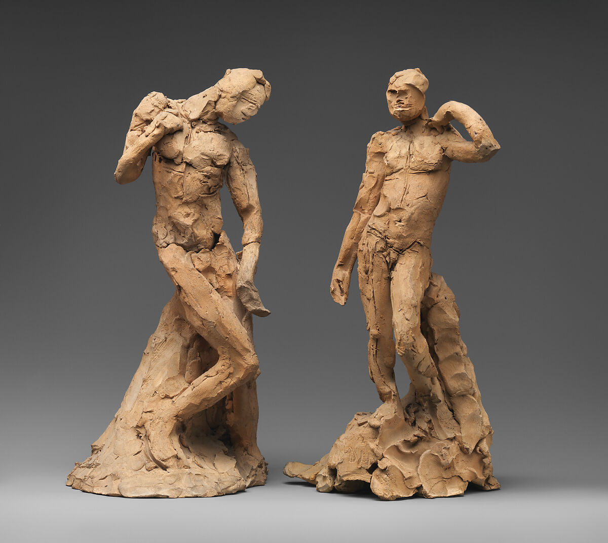
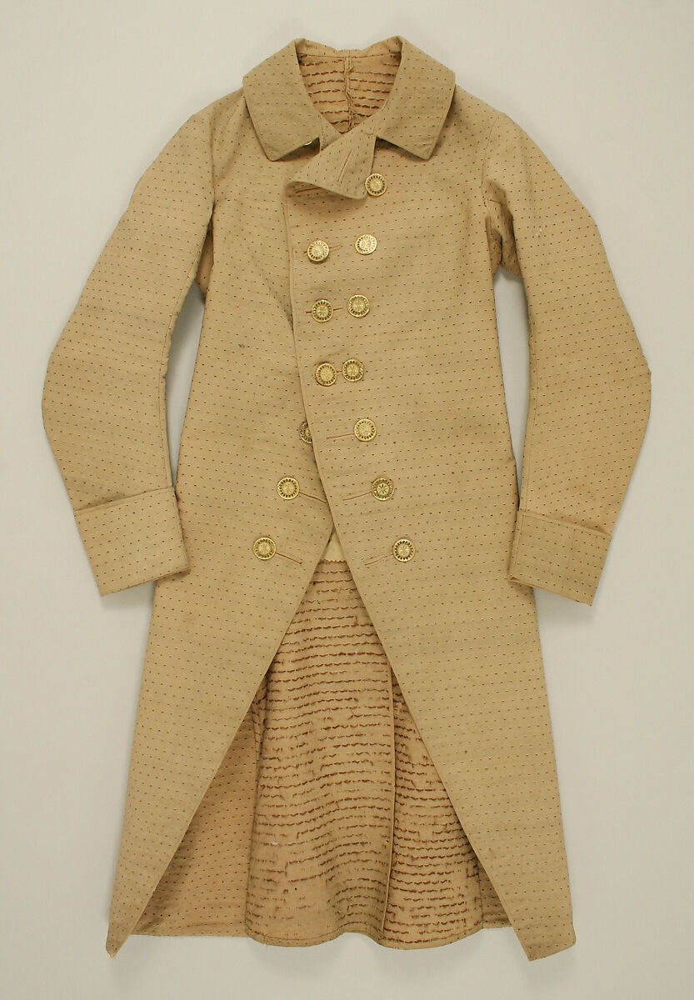
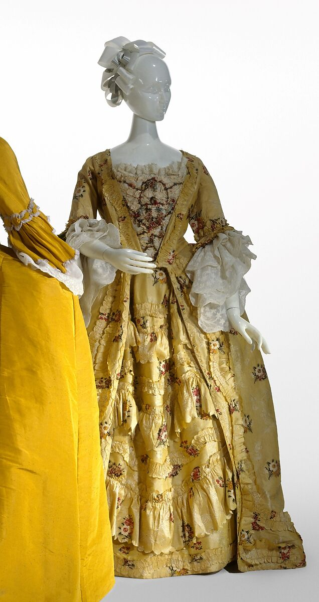

# 인체·재질·움직임 연구 2차

기록일: 2026-11-15. 실제 참고 이미지를 열어 관찰한 내용과 새 코드의 실험 결과를 연결한다. 아래 관찰은 미술 제작을 위한 해석이다. 특정 신체가 사람의 표준이라는 뜻은 아니며, 2~8등신은 나이 구분이 아닌 조형 비례다. 기존 캐릭터의 좌표·모델·텍스처는 사용하지 않았다.

[기본형 연구실 열기](../../pixel-lab/) · [실행 일지](journal.html) · [복구 범위](architecture.html)

## 01. 골격에서 연속적인 몸으로

**한 줄:** 흉곽·골반·관절의 연결이 먼저다.

**한 문장:** 골격 도해를 참고해 몸통의 큰 덩어리와 팔·다리의 회전 중심을 분리하고, 표면은 끊어지지 않는 윤곽으로 연결했다.

**원전:** OpenStax, Anatomy and Physiology 2e, [어깨띠](https://openstax.org/books/anatomy-and-physiology-2e/pages/8-1-the-pectoral-girdle), [골반띠](https://openstax.org/books/anatomy-and-physiology-2e/pages/8-3-the-pelvic-girdle-and-pelvis). 정면·후면 골격 이미지를 직접 확인했다. 현재 [머리말의 이용 조건](https://openstax.org/books/anatomy-and-physiology-2e/pages/preface)은 CC BY-NC-SA 4.0이다. 과거 조건을 추정하지 않고 원본 그림은 제품에 포함하지 않는다.

**관찰과 해석:** 쇄골이 목에서 어깨로 이어지는 방향, 흉곽과 골반 사이의 유연한 허리, 골반에서 다리로 내려가는 연결, 손목과 손의 길이를 따로 살폈다. 뼈의 위치와 외부 실루엣은 같지 않으므로 도해를 그대로 외곽선으로 쓰지 않았다. 근육 점을 추가하는 방식보다 몸통의 앞·옆·뒤 부피가 이어지는지 먼저 비교했다.

**구현:** 흉곽·허리·골반을 연속 단면으로 연결하고 목·어깨 덮개·쇄골 기울기를 더했다. 성인형에 해당하는 긴 비례에는 가슴과 엉덩이의 부피를 연구용으로 추가했다. 옷 안쪽 세부 표면이 옷을 뚫고 드러나지 않도록 가린다. 기본·가느다란·튼튼한 체형을 별도 축으로 두었다.

**주요 개념:** 큰 덩어리, 관절 중심, 표면 연결, 체형 변화, 정면과 측면의 일치. 현재 비례값은 새로 정한 설계값이며 인체 계측 데이터가 아니다. 견갑골의 움직임과 다양한 체형의 실측 비교는 후속 과제다.

## 02. 무게와 정지 자세

**한 줄:** 선 자세에도 하중을 받는 다리가 있다.

**한 문장:** 로댕의 인체 조각 사진에서 몸통·골반의 방향과 지지 다리의 관계를 관찰하고, 기본 자세의 과도한 무릎 굽힘을 수정했다.

**원전:** The Metropolitan Museum of Art, [Rodin 인체 조각, 소장번호 207693](https://www.metmuseum.org/art/collection/search/207693). 제공 사진의 Public Domain 표기를 확인했다.

사진: The Metropolitan Museum of Art, Public Domain. 작품의 외형이나 포즈를 캐릭터 자산으로 복제하지 않았다.

**관찰과 해석:** 몸통과 골반이 반드시 같은 방향으로 기울지 않는다. 한쪽 다리가 하중을 받으면 반대편 다리와 팔의 여유가 전체 실루엣에 드러난다. 사진 한 장만으로 정확한 관절 좌표나 무게 중심을 얻을 수는 없다.

**구현:** 기본형에서 발목까지의 길이와 허벅지·종아리 길이가 맞지 않아 무릎이 구부러지던 문제를 고쳤다. 보행에서는 골반을 조금 낮추고 두 뼈로 발목 목표를 따라가게 했다. 정지 자세는 비교를 위한 중립 자세로 유지한다. 체중 이동·비대칭 선 자세를 도입할 때는 지지발과 몸통의 균형을 별도로 검사한다.

**주요 개념:** 지지 다리, 반대 기울기, 중립 기준, 관절 길이. 조각의 미적 과장을 해부학적 사실로 해석하지 않는다.

## 03. 실제 보행과 픽셀 핵심 장면

**한 줄:** 접지와 발을 옮기는 구간을 구분한다.

**한 문장:** Muybridge의 연속 보행 사진과 Saint11의 걷기·네발 걷기 자료를 비교해, 지지·들기·앞으로 옮기기·착지를 나누었다.

**원전:** Library of Congress, [Muybridge 보행 연속 사진](https://www.loc.gov/pictures/item/93503819/); Pedro Medeiros/Saint11, [Walk](https://github.com/saint11/Saint11Tutorials/blob/master/Walk.gif), [4 Legs Walk](https://github.com/saint11/Saint11Tutorials/blob/master/4LegsWalk.gif). 사진과 GIF의 핵심 장면을 직접 열어 확인했다. Saint11 자료는 [CC BY 4.0](https://github.com/saint11/Saint11Tutorials/blob/master/README.md)이며, 여기에는 원본 프레임을 복제하지 않는다.

**관찰과 해석:** 연속 사진은 다리의 겹침과 팔의 반대 움직임을 읽는 데 도움이 된다. 픽셀 자료에서는 중요한 접촉 장면의 구별이 특히 중요하다. 실제 시간 비율을 측정했다고 주장하지 않는다.

**구현:** 사람 걷기의 한 주기를 지지 60%·옮김 40%로, 달리기는 지지 42%로 정했다. 이는 실험용 선택이다. 지지발 높이를 고정하고 이동하는 발에는 곡선을 적용했다. 14형 × 24시점에서 지지·옮김 672개 발 상태를 검사했다. 최대 뼈 길이 오차는 머리 길이 단위 약 0.00663이다. 네발형에는 앞뒤 다리의 위상 차이를 적용했다.

**주요 개념:** 접촉, 지지, 통과, 착지, 팔의 반대 움직임, 다리 위상. 생활 무대 이동 속도와 발의 뒤쪽 이동량을 정확히 맞추는 발 미끄러짐 검사는 아직 남아 있다.

## 04. 실제 옷의 구조와 재질

**한 줄:** 옷의 두께와 접힘이 재질을 설명한다.

**한 문장:** 박물관의 울·실크 의복 사진에서 옷깃·소매·주름·겹침을 관찰해, 같은 형태라도 다른 명암과 두께로 구분되도록 했다.

**원전:** The Metropolitan Museum of Art, [Coat, 약 1785, wool·silk](https://www.metmuseum.org/art/collection/search/81262), [Dress, silk·wool](https://www.metmuseum.org/art/collection/search/82007). 두 사진 모두 Public Domain 표시를 확인했다.

사진: The Metropolitan Museum of Art, Public Domain.

**관찰과 해석:** 코트는 옷깃과 앞섶이 만드는 두꺼운 층이 눈에 띈다. 드레스는 넓게 흐르는 주름과 밝은 능선이 구별된다. 사진의 광택에는 조명·보존 상태·촬영 조건도 영향을 주므로 픽셀에서 보이는 모든 차이를 섬유 종류의 차이라고 단정하지 않는다.

**구현:** 셔츠·코트·갑옷, 바지·치마를 나눴다. 코트는 몸에서 떨어진 두께와 긴 밑단, 셔츠는 짧은 소매, 치마는 넓어진 하단과 주름을 갖는다. 면·울·실크·가죽 네 재질은 동일 의상에서 팔레트 단계와 반사 폭을 달리한다. 주름은 구조적 근사이며 천 물리 시뮬레이션은 아니다.

**주요 개념:** 두께, 앞섶, 옷깃, 소매 끝, 큰 주름, 재질과 조명의 분리. 가방·목도리·고글과 머리 5종도 독립 선택한다. 긴 머리와 묶은 머리에는 덩어리 및 주기적 흔들림을 주었지만 실제 모발 시뮬레이션은 아니다.

## 05. 픽셀에서 재질을 읽는 기준

**한 줄:** 작은 반짝임보다 큰 명암 관계가 먼저다.

**한 문장:** Saint11의 금속 자료를 참고해 밝은 반사와 어두운 면의 대비를 유지하고, 천·피부·털과 구분했다.

**원전:** Pedro Medeiros/Saint11, [Metal](https://github.com/saint11/Saint11Tutorials/blob/master/Metal.gif), CC BY 4.0. 실제 그림을 열어 밝은 띠와 그림자의 배치를 확인했다.

**관찰과 적용:** 금속은 좁은 밝은 면과 깊은 어두운 면이 연결될 때 부피가 잘 읽힌다. 전체에 밝은 점을 흩뿌리면 형상이 약해진다. 새 렌더러는 면의 방향을 계산한 뒤 5단계 팔레트로 묶는다. 금속·황동·머리·천·가죽·털·돌에 별도의 응답을 적용한다. 옷의 패턴은 화면 좌표가 아닌 물체의 좌표에 붙여 같은 입력에서 결과가 바뀌지 않게 했다.

**확인:** 동일 코트의 면·울·실크·가죽 출력이 네 가지로 구별되고, 같은 입력을 반복하면 바이트 단위로 같은 결과다. 이 검사는 구별 가능성과 결정성을 확인할 뿐, 사실적인 재질이나 높은 미적 완성도를 증명하지 않는다. 64px에서는 과도한 무늬가 얼굴과 손을 가릴 수 있어 계속 비교한다.

## 06. 현재 시안과 움직이는 시험 공간

새 형태는 사람·여우·고양이·새·작은 용·숲의 골렘·탐사 로봇·외계 탐험가 8종이다. 옷 조합을 포함한 13개 시안을 한 화면에서 고르고 저장할 수 있다. 사람은 숨 쉬기·걷기·달리기·손 흔들기·앉기·살펴보기·손 뻗기·잠들기를 제공한다. 다른 종류는 실제 구현한 동작만 선택 목록에 표시한다.

책꽂이·화분·공·의자·등을 놓은 공간은 같은 재현번호에서 같은 배치와 선택 흐름을 재생한다. 캐릭터는 대상 선택 → 접근 → 관찰 → 반응을 수행하며 방문한 사물을 기억한다. 처음 보는 사물, 휴식 필요, 탐색·연습 경험이 선택 가중치에 들어간다. 이는 학습된 신경망이나 범용 화면 인식이 아니라 명시적으로 만든 행동 규칙의 첫 실험이다.

보행 자체, 사물 접촉, 도구 사용은 구분한다. 현재 공 앞에서 달리기 동작을 선택할 수 있지만 공을 실제로 차서 이동시키지는 않는다. 의자에 접근해 앉는 포즈를 취하지만 좌판과 엉덩이의 접촉 정합은 후속 작업이다. 이러한 차이를 일지에서 숨기지 않는다.

## 07. 검사 결과와 다음 개선 기준

| 검사 | 실제 결과 | 의미와 한계 |
|---|---|---|
| 기존 설정 읽기 | 통과 | 새 외형 필드는 기본값으로 보충 |
| 지지발·관절 길이 | 통과, 672개 발 상태 | 몸 좌표계에서 접지 검사; 실제 이동의 미끄러짐은 별도 |
| 96·128px, 14형, 64각도 | 1,792개 통과 | 빈 그림·테두리 잘림 검사 |
| 13시안, 64각도 | 832개 통과 | 다양한 형태의 회전 누락 검사 |
| 지원 동작, 8프레임, 네 방향 | 2,688개 통과 | 울 코트 잠들기는 64px 측면 프레임 차이가 보이지 않는 경고 1건 |
| 네 재질 | 구별·결정성 통과 | 미술 평가의 대체물이 아님 |
| 공간 행동 | 4/4 통과 | 8종 각각 가상 10분, 사물 5개 방문, 범위·사건·기억 검사 |
| 실제 브라우저 | 자율 반응과 기록, 8프레임 PNG 저장 확인 | PNG 1024×128; 화면과 파일의 크기 확인 |

이번 렌더 검사는 총 5,312개다. 통과는 작품 완성 선언이 아니다. 다음은 발 미끄러짐, 의자 접촉, 공의 이동, 앉을 때 옷의 겹침, 동물별 실루엣 차이, 작은 얼굴과 손의 가독성 순으로 비교한다. 각 후보의 이전 버전을 보존하고 동일 조건에서 나란히 판단한다.
