# 인체·재질·움직임 연구 2차

기록일: 2026-11-15. 실제 참고 이미지를 열어 관찰한 내용과 새 코드의 실험 결과를 연결한다. 아래 관찰은 미술 제작을 위한 해석이다. 특정 신체가 사람의 표준이라는 뜻은 아니며, 2~8등신은 나이 구분이 아닌 조형 비례다. 기존 캐릭터의 좌표·모델·텍스처는 사용하지 않았다.

[기본형 연구실 열기](../../pixel-lab/) · [실행 일지](journal.html) · [복구 범위](architecture.html)

## 01. 골격에서 연속적인 몸으로

**한 줄:** 흉곽·골반·관절의 연결이 먼저다.

**한 문장:** 골격 도해를 참고해 몸통의 큰 덩어리와 팔·다리의 회전 중심을 분리하고, 표면은 끊어지지 않는 윤곽으로 연결했다.

**원전:** OpenStax, Anatomy and Physiology 2e, [어깨띠](https://openstax.org/books/anatomy-and-physiology-2e/pages/8-1-the-pectoral-girdle), [골반띠](https://openstax.org/books/anatomy-and-physiology-2e/pages/8-3-the-pelvic-girdle-and-pelvis). 정면·후면 골격 이미지를 직접 확인했다. 현재 [머리말의 이용 조건](https://openstax.org/books/anatomy-and-physiology-2e/pages/preface)은 CC BY-NC-SA 4.0이다. 과거 조건을 추정하지 않고 원본 그림은 제품에 포함하지 않는다.

**관찰과 해석:** 쇄골이 목에서 어깨로 이어지는 방향, 흉곽과 골반 사이의 유연한 허리, 골반에서 다리로 내려가는 연결, 손목과 손의 길이를 따로 살폈다. 뼈의 위치와 외부 실루엣은 같지 않으므로 도해를 그대로 외곽선으로 쓰지 않았다. 근육 점을 추가하는 방식보다 몸통의 앞·옆·뒤 부피가 이어지는지 먼저 비교했다.

**구현:** 흉곽·허리·골반을 연속 단면으로 연결하고 목·어깨 덮개·쇄골 기울기를 더했다. 성인형에 해당하는 긴 비례에는 가슴과 엉덩이의 부피를 연구용으로 추가했다. 옷 안쪽 세부 표면이 옷을 뚫고 드러나지 않도록 가린다. 기본·가느다란·튼튼한 체형을 별도 축으로 두었다.

**주요 개념:** 큰 덩어리, 관절 중심, 표면 연결, 체형 변화, 정면과 측면의 일치. 현재 비례값은 새로 정한 설계값이며 인체 계측 데이터가 아니다. 견갑골의 움직임과 다양한 체형의 실측 비교는 후속 과제다.

## 02. 무게와 정지 자세

**한 줄:** 선 자세에도 하중을 받는 다리가 있다.

**한 문장:** 로댕의 인체 조각 사진에서 몸통·골반의 방향과 지지 다리의 관계를 관찰하고, 기본 자세의 과도한 무릎 굽힘을 수정했다.

**원전:** The Metropolitan Museum of Art, [Rodin 인체 조각, 소장번호 207693](https://www.metmuseum.org/art/collection/search/207693). 제공 사진의 Public Domain 표기를 확인했다.

사진: The Metropolitan Museum of Art, Public Domain. 작품의 외형이나 포즈를 캐릭터 자산으로 복제하지 않았다.

**관찰과 해석:** 몸통과 골반이 반드시 같은 방향으로 기울지 않는다. 한쪽 다리가 하중을 받으면 반대편 다리와 팔의 여유가 전체 실루엣에 드러난다. 사진 한 장만으로 정확한 관절 좌표나 무게 중심을 얻을 수는 없다.

**구현:** 기본형에서 발목까지의 길이와 허벅지·종아리 길이가 맞지 않아 무릎이 구부러지던 문제를 고쳤다. 보행에서는 골반을 조금 낮추고 두 뼈로 발목 목표를 따라가게 했다. 정지 자세는 비교를 위한 중립 자세로 유지한다. 체중 이동·비대칭 선 자세를 도입할 때는 지지발과 몸통의 균형을 별도로 검사한다.

**주요 개념:** 지지 다리, 반대 기울기, 중립 기준, 관절 길이. 조각의 미적 과장을 해부학적 사실로 해석하지 않는다.

## 03. 실제 보행과 픽셀 핵심 장면

**한 줄:** 접지와 발을 옮기는 구간을 구분한다.

**한 문장:** Muybridge의 연속 보행 사진과 Saint11의 걷기·네발 걷기 자료를 비교해, 지지·들기·앞으로 옮기기·착지를 나누었다.

**원전:** Library of Congress, [Muybridge 보행 연속 사진](https://www.loc.gov/pictures/item/93503819/); Pedro Medeiros/Saint11, [Walk](https://github.com/saint11/Saint11Tutorials/blob/master/Walk.gif), [4 Legs Walk](https://github.com/saint11/Saint11Tutorials/blob/master/4LegsWalk.gif). 사진과 GIF의 핵심 장면을 직접 열어 확인했다. Saint11 자료는 [CC BY 4.0](https://github.com/saint11/Saint11Tutorials/blob/master/README.md)이며, 여기에는 원본 프레임을 복제하지 않는다.

**관찰과 해석:** 연속 사진은 다리의 겹침과 팔의 반대 움직임을 읽는 데 도움이 된다. 픽셀 자료에서는 중요한 접촉 장면의 구별이 특히 중요하다. 실제 시간 비율을 측정했다고 주장하지 않는다.

**구현:** 사람 걷기의 한 주기를 지지 60%·옮김 40%로, 달리기는 지지 42%로 정했다. 이는 실험용 선택이다. 지지발 높이를 고정하고 이동하는 발에는 곡선을 적용했다. 14형 × 24시점에서 지지·옮김 672개 발 상태를 검사했다. 최대 뼈 길이 오차는 머리 길이 단위 약 0.00663이다. 네발형에는 앞뒤 다리의 위상 차이를 적용했다.

**주요 개념:** 접촉, 지지, 통과, 착지, 팔의 반대 움직임, 다리 위상. 생활 무대 이동 속도와 발의 뒤쪽 이동량을 정확히 맞추는 발 미끄러짐 검사는 아직 남아 있다.

## 04. 실제 옷의 구조와 재질

**한 줄:** 옷의 두께와 접힘이 재질을 설명한다.

**한 문장:** 박물관의 울·실크 의복 사진에서 옷깃·소매·주름·겹침을 관찰해, 같은 형태라도 다른 명암과 두께로 구분되도록 했다.

**원전:** The Metropolitan Museum of Art, [Coat, 약 1785, wool·silk](https://www.metmuseum.org/art/collection/search/81262), [Dress, silk·wool](https://www.metmuseum.org/art/collection/search/82007). 두 사진 모두 Public Domain 표시를 확인했다.

사진: The Metropolitan Museum of Art, Public Domain.

**관찰과 해석:** 코트는 옷깃과 앞섶이 만드는 두꺼운 층이 눈에 띈다. 드레스는 넓게 흐르는 주름과 밝은 능선이 구별된다. 사진의 광택에는 조명·보존 상태·촬영 조건도 영향을 주므로 픽셀에서 보이는 모든 차이를 섬유 종류의 차이라고 단정하지 않는다.

**구현:** 셔츠·코트·갑옷, 바지·치마를 나눴다. 코트는 몸에서 떨어진 두께와 긴 밑단, 셔츠는 짧은 소매, 치마는 넓어진 하단과 주름을 갖는다. 면·울·실크·가죽 네 재질은 동일 의상에서 팔레트 단계와 반사 폭을 달리한다. 주름은 구조적 근사이며 천 물리 시뮬레이션은 아니다.

**주요 개념:** 두께, 앞섶, 옷깃, 소매 끝, 큰 주름, 재질과 조명의 분리. 가방·목도리·고글과 머리 5종도 독립 선택한다. 긴 머리와 묶은 머리에는 덩어리 및 주기적 흔들림을 주었지만 실제 모발 시뮬레이션은 아니다.

## 05. 픽셀에서 재질을 읽는 기준

**한 줄:** 작은 반짝임보다 큰 명암 관계가 먼저다.

**한 문장:** Saint11의 금속 자료를 참고해 밝은 반사와 어두운 면의 대비를 유지하고, 천·피부·털과 구분했다.

**원전:** Pedro Medeiros/Saint11, [Metal](https://github.com/saint11/Saint11Tutorials/blob/master/Metal.gif), CC BY 4.0. 실제 그림을 열어 밝은 띠와 그림자의 배치를 확인했다.

**관찰과 적용:** 금속은 좁은 밝은 면과 깊은 어두운 면이 연결될 때 부피가 잘 읽힌다. 전체에 밝은 점을 흩뿌리면 형상이 약해진다. 새 렌더러는 면의 방향을 계산한 뒤 5단계 팔레트로 묶는다. 금속·황동·머리·천·가죽·털·돌에 별도의 응답을 적용한다. 옷의 패턴은 화면 좌표가 아닌 물체의 좌표에 붙여 같은 입력에서 결과가 바뀌지 않게 했다.

**확인:** 동일 코트의 면·울·실크·가죽 출력이 네 가지로 구별되고, 같은 입력을 반복하면 바이트 단위로 같은 결과다. 이 검사는 구별 가능성과 결정성을 확인할 뿐, 사실적인 재질이나 높은 미적 완성도를 증명하지 않는다. 64px에서는 과도한 무늬가 얼굴과 손을 가릴 수 있어 계속 비교한다.

## 06. 현재 시안과 움직이는 시험 공간

새 형태는 사람·여우·고양이·새·작은 용·숲의 골렘·탐사 로봇·외계 탐험가 8종이다. 옷 조합을 포함한 13개 시안을 한 화면에서 고르고 저장할 수 있다. 사람은 숨 쉬기·걷기·달리기·손 흔들기·앉기·살펴보기·손 뻗기·잠들기를 제공한다. 다른 종류는 실제 구현한 동작만 선택 목록에 표시한다.

책꽂이·화분·공·의자·등을 놓은 공간은 같은 재현번호에서 같은 배치와 선택 흐름을 재생한다. 캐릭터는 대상 선택 → 접근 → 관찰 → 반응을 수행하며 방문한 사물을 기억한다. 처음 보는 사물, 휴식 필요, 탐색·연습 경험이 선택 가중치에 들어간다. 이는 학습된 신경망이나 범용 화면 인식이 아니라 명시적으로 만든 행동 규칙의 첫 실험이다.

보행 자체, 사물 접촉, 도구 사용은 구분한다. 2차에서는 공 앞에서 달리기 동작만 선택했다. 아래 3차 보완에서 공 차기와 공의 이동을 연결했다. 의자에 접근해 앉는 포즈를 취하지만 좌판과 엉덩이의 접촉 정합은 후속 작업이다. 이러한 차이를 일지에서 숨기지 않는다.

## 07. 검사 결과와 다음 개선 기준

| 검사 | 실제 결과 | 의미와 한계 |
|---|---|---|
| 기존 설정 읽기 | 통과 | 새 외형 필드는 기본값으로 보충 |
| 지지발·관절 길이 | 통과, 672개 발 상태 | 몸 좌표계에서 접지 검사; 실제 이동의 미끄러짐은 별도 |
| 96·128px, 14형, 64각도 | 1,792개 통과 | 빈 그림·테두리 잘림 검사 |
| 13시안, 64각도 | 832개 통과 | 다양한 형태의 회전 누락 검사 |
| 지원 동작, 8프레임, 네 방향 | 2,688개 통과 | 울 코트 잠들기는 64px 측면 프레임 차이가 보이지 않는 경고 1건 |
| 네 재질 | 구별·결정성 통과 | 미술 평가의 대체물이 아님 |
| 공간 행동 | 4/4 통과 | 8종 각각 가상 10분, 사물 5개 방문, 범위·사건·기억 검사 |
| 실제 브라우저 | 자율 반응과 기록, 8프레임 PNG 저장 확인 | PNG 1024×128; 화면과 파일의 크기 확인 |

이번 렌더 검사는 총 5,312개다. 통과는 작품 완성 선언이 아니다. 다음은 발 미끄러짐, 의자 접촉, 공의 이동, 앉을 때 옷의 겹침, 동물별 실루엣 차이, 작은 얼굴과 손의 가독성 순으로 비교한다. 각 후보의 이전 버전을 보존하고 동일 조건에서 나란히 판단한다.

## 08. 3차 보완: 보폭과 공의 움직임

**문제:** 이전 생활 무대는 화면 이동 속도와 다리의 주기를 따로 계산했다. 몸 좌표계의 발이 땅에 붙어 있어도 화면에서는 미끄러질 수 있었다. 또한 그림의 가장 낮은 픽셀을 매번 바닥에 맞추면 달리기의 뜬 발도 강제로 바닥에 내려온다.

**수정:** 발이 지지 구간에서 뒤로 움직이는 거리와 캐릭터의 실제 화면 이동 거리를 연결했다. 그림 경계 대신 몸의 기준 바닥을 화면 좌표로 투영하여 사용한다. 화면 너비가 달라져도 접근 속도는 표시 픽셀 기준으로 일정하게 유지하며 사물 앞에 멈추는 거리도 보정한다.

**공 실험:** 사람형에 공 차기 동작을 추가했다. 공을 향해 접근·관찰한 뒤 동작의 정해진 시점에 한 번 충격을 주고, 공의 수평 이동·상하 튀기·감쇠·좌우 반사를 계산한다. 함께 만날 사물을 직접 고르는 단추도 추가했다. 이 첫 물리 반응은 동작 시점에 연결한 규칙이며 발끝 메시와 공의 충돌을 정밀하게 푸는 물리 엔진은 아니다. 높이는 각 위치의 무대 표면에 상대적인 값이다.

**검사:** 새 검사 5/5 통과. 남녀 14형의 좌우 이동에서 지지발 좌표 20,012쌍을 비교해 최대 잔차 약 2.35×10⁻¹⁴ 표시 픽셀이었다. 이는 평지의 반올림 전 좌표 결과다. 실제 픽셀 반올림·화면 갱신 간격·경사면의 양발 높이 차이는 별도 문제다. 공 차기 14형 × 8시점 × 16방향, 총 1,792개 렌더가 비어 있거나 잘리지 않았다. 지연 충격 1회, 튀기·착지·완전 정지, 양쪽 경계 반사도 통과했다.

**아직 남은 것:** 의자 높이에 맞춘 앉기, 경사면의 다리별 접지, 공과 발의 정확한 접촉, 사물끼리 충돌, 옷의 동작 중 교차, 여러 친구의 공동 행동이다. 2차 체크포인트는 별도 보존했다.

## 09. 4차 보완: 실제 동물과 윤곽 비교

[동물형 변경 전후 비교 열기](../../pixel-lab/comparison.html). 같은 해상도·방향·조명에서 이 새 프로젝트의 3차와 4차를 나란히 본다. 실루엣만 보기, 방향·원본 크기 선택, 비교 그림 저장을 제공한다. 여기의 이전 시안은 새 프로젝트의 중간 결과이며, 보존만 하기로 한 옛 서비스 캐릭터가 아니다.

**여우 — 한 줄:** 귀는 뿔이 아니라 넓은 면이다. **한 문장:** 사막여우 사진에서 넓어진 귀의 면과 끝으로 좁아지는 주둥이, 볼과 코의 연결을 관찰해 고쳤다. [Smithsonian의 설명과 실제 사진](https://www.nationalzoo.si.edu/animals/news/how-does-fennec-fox-survive-desert-and-other-questions-answered)을 직접 확인했다. 사막여우는 여우 전체를 대표하지 않으므로 현재 결과는 여러 특징을 조합한 창작 여우형으로 다룬다. 기존 뿔 같은 귀의 단면을 넓히고, 둥근 주둥이를 끝으로 좁아지는 구조로 교체했다. 주요 개념은 귀의 면·내외부 두께·주둥이의 쐐기형 연결이다.

**고양이 — 한 줄:** 얼굴 장식보다 볼·가슴·뒷다리가 먼저다. **한 문장:** 특정 단모 품종의 사진에서 볼과 턱, 짧은 주둥이, 넓은 가슴과 뒷다리 부피를 관찰해 여우형과 다른 몸으로 고쳤다. [CFA American Shorthair](https://cfa.org/breed/american-shorthair/)의 실제 사진과 설명을 참고했다. 확인한 사진의 촬영자는 Larry Johnson이며 원본의 표시는 유지했다. 특정 품종의 체형을 모든 고양이의 표준으로 삼지 않는다. 볼·입 주변의 덩어리를 나누고 눈·코의 크기, 올라가는 가는 꼬리, 뒷발목 연결을 조정했다. 회색 털은 새 창작 팔레트다. 주요 개념은 얼굴의 폭·가슴·후지 부피·발목과 발의 구분이다.

**새 — 한 줄:** 접힌 날개와 짧은 목이 몸통에 붙는다. **한 문장:** 작은 산새 사진에서 짧은 목, 둥근 몸, 몸에 접힌 날개, 좁고 긴 꼬리와 앞뒤 발가락의 관계를 관찰했다. [Cornell Lab의 Black-capped Chickadee 설명](https://www.allaboutbirds.org/guide/Black-capped_Chickadee/id)과 [공개 사진 자료](https://ebird.org/species/bkcchi)를 참고했다. 사진 자료 번호는 302473191이다. 세로로 긴 몸을 낮고 둥근 구조로 바꾸고, 접힌 날개와 비행깃 덩어리를 나눴다. 뒤쪽 발가락을 추가하고 발이 들릴 때 앞 발가락이 바닥에 붙어 남던 문제도 수정했다. 주요 개념은 목의 연결·날개 접힘·깃의 겹침·꼬리 방향이다. 종의 정확한 재현을 목표로 한 모델은 아니다.

세 원본 사진은 관찰용으로만 확인했다. 공개 연구 묶음이나 캐릭터 텍스처로 재배포하지 않는다. 새 결과는 사진의 픽셀을 복사하지 않고 독립적인 메시와 팔레트로 생성한다.

**검사와 비교:** 변경된 동물·용 네 종류의 48·96px 전 방향 512개, 지원 동작의 8시점·네 방향 1,344개 렌더에 빈 그림과 잘림이 없었다. 여우와 고양이의 불투명 픽셀 영역 겹침 비율은 정면 약 0.922→0.728, 45도 약 0.866→0.750, 옆면 약 0.804→0.705로 줄었다. 색을 제외한 모양이 더 달라졌다는 근거이며 미적 우수성 점수는 아니다. 실제 브라우저에서 변경 전후의 세 쌍이 표시되는 것을 확인했다. 반복 움직임의 자연스러움과 종별 관절 실측은 계속 검토한다.

## 10. 수면의 호흡 — 실제 경고를 닫은 첫 개선 주기

2026-11-16. 64px 울 코트의 수평 90도 수면에서 여덟 프레임이 같은 그림으로 남는 경고를 재현했다. 누운 몸을 세로로 바라보는 각도에서는 코트가 몸통의 미세한 움직임을 가렸다.

**가설과 시안:** 몸 전체를 흔드는 대신 목·골반은 고정하고 흉곽과 상의의 같은 영역을 함께 부풀린다. 머리 높이를 1로 둔 단위로 0, 0.025, 0.05, 0.08, 0.12를 비교했다. 문제가 있던 입력의 고유 프레임은 각각 1, 2, 2, 4, 5개였다. 작은 두 후보는 한 픽셀만 달라지는 상태라 채택하지 않았다.

**시각 판단:** 실제 64px 여덟 프레임을 2배 정수 확대해 90도와 45도에서 나란히 보았다. 0.08은 코트의 몸통 변화가 읽히고 머리·발과 분리된 국소 변화였다. 0.12는 더 큰 확장이 필요하다는 근거가 없어 보류했다. 이 판단은 제작 에이전트의 비교 판단이며 사용자 승인이나 전문가 외부 평가를 뜻하지 않는다.

**평가:** 후보 조정에 쓰지 않은 135·225도 × 48·96·128px의 고유 프레임 합은 26에서 47로 늘었다. 누락·잘림·비정상 좌표는 0이었다. 이는 이번 변경의 분리된 회귀 사례이며, 처음 접한 독립 자료로 일반화 성능을 증명한 것은 아니다. 옷 6종·14비율·전 회전을 포함한 수면 렌더 2,240개와 112개 접지 상태, 루프 연결, 비수면 동작 보존 검사를 통과했다. 기존 동작 검사의 경고도 1개에서 0개로 줄었다.

**적용:** 호흡 0.08을 기본값으로 채택했다. [다섯 후보 비교 화면](../../pixel-lab/sleep-study.html)에서 옷·크기·각도를 바꾸고 수동 프레임·재생을 비교할 수 있다. [검사 원본](../../pixel-lab/qa/sleep-tests.json)에 후보 계약과 실측값을 남겼다. 엔진은 이 경고를 실제 재검사 후 resolved로 바꾸었고 이전 관측은 보존했다. 신규 비교 화면의 실제 브라우저 조작은 아직 미검증이다.

## 11. 인체 집중 검토 — 부위 수와 완성도를 혼동하지 않기

2026-11-16. 6차에서 체형 20개, 얼굴 부품 각 20개, 머리 모양 100개를 조절 가능한 초안으로 구현했다. 서로 다른 그림이 나온다는 검사는 형태의 자연스러움을 증명하지 않는다. 사용자는 전신·얼굴의 수준이 낮다고 평가했고, 이후 확장을 보류하도록 지시했다. 이 평가를 기준으로 인체 승인 상태를 false로 유지한다.

새 프로젝트의 6차 코드를 고정하여 7차와 같은 해상도·카메라·재질에서 비교한다. **완성된 기본형은 아직 없다.** 장르별 의상·소품·동작 목록 확장과 여성형 30종 이상의 체형 양산은 기본형이 안정될 때까지 보류한다.

## 12. 어깨·팔 — 공과 원통으로 보이는 이유

[Proko 삼각근](https://www.proko.com/course-lesson/how-to-draw-deltoids-anatomy-for-artists/)과 [어깨뼈](https://www.proko.com/course-lesson/anatomy-of-the-shoulder-bones), [OpenStax 상지 근육](https://openstax.org/books/anatomy-and-physiology-2e/pages/11-5-muscles-of-the-pectoral-girdle-and-upper-limbs)을 대조했다. 삼각근을 어깨 위에 놓인 공으로 다루면 길이와 부착 방향이 사라진다. 쇄골·견갑골·위팔뼈와의 관계, 앞·옆·뒤의 면 변화가 함께 필요하다.

**현재 결함:** 어깨가 솟아 보였고, 흉곽 옆에 팔이 바로 붙었다. 상완과 전완은 같은 방향의 타원 단면을 줄인 관처럼 보였다. 팔꿈치가 둥근 구로 튀고, 손은 몸에 비해 작았다.

**7차 적용:** 성인형의 별도 어깨 구를 제거했다. 위팔 표면의 상부에서 삼각근 부피가 아래로 이어지고, 앞쪽 이두근과 뒤쪽 삼두근의 면이 달라지도록 했다. 전완은 팔꿈치 근처의 두께가 손목으로 갈수록 줄고 납작해지며, 안팎의 가장 볼록한 위치가 서로 다르게 배치된다. 엄지와 손가락의 길이, 손바닥 크기도 수정했다.

[Proko 전완](https://www.proko.com/course-lesson/how-to-draw-forearms-anatomy-for-artists/)의 실제 팔 사진과 비대칭 윤곽 도판을 직접 봤다. 전완의 양쪽 윤곽을 거울처럼 맞추면 부풀린 마디처럼 보인다는 점을 현재 모델과 대조했다. 여기의 비대칭은 좌우 팔을 임의로 다르게 만드는 것이 아니라 한 팔의 안팎 윤곽이 서로 다른 높이에서 변하는 구조다.

**남은 결함:** 겨드랑이의 앞·뒤 주름과 가슴/등 근육의 연결이 불충분하다. 팔을 들 때 견갑골과 쇄골이 함께 움직이지 않는다. 손목의 회내·회외와 손바닥 방향도 단순하다. 현재의 표면 변경만으로 상지 해부학이 완성됐다고 판단하지 않는다.

## 13. 다리 — 골반에서 발까지 이어지는 흐름

[Proko 대퇴사두근](https://www.proko.com/course-lesson/how-to-draw-legs-the-quad-muscles), [내전근](https://www.proko.com/course-lesson/how-to-draw-legs-the-adductors/), [하퇴](https://www.proko.com/course-lesson/how-to-draw-the-lower-leg-anatomy-for-artists), [OpenStax 하지 근육](https://openstax.org/books/anatomy-and-physiology-2e/pages/11-6-appendicular-muscles-of-the-pelvic-girdle-and-lower-limbs)을 참고했다. 하퇴의 근육·힘줄·뼈 면을 그린 도판도 직접 확인했다.

**현재 결함:** 골반 아래에 수직 봉 두 개가 달린 것처럼 보였다. 허벅지와 종아리가 대칭으로 부풀고, 둥근 무릎을 지나 발목이 갑자기 가늘어졌다. 측면 발의 길이가 부족해 지지 면적이 작아 보였다.

**7차 적용:** 고관절에서 무릎·발목으로 내려오는 축을 안쪽으로 연결했다. 허벅지의 안쪽 내전근 덩어리, 앞쪽 대퇴사두근, 뒤쪽 햄스트링 방향을 구분하는 표면을 만들었다. 무릎 안쪽 근육의 부피가 바깥보다 낮게 이어지도록 했다. 종아리의 안팎 볼록한 위치를 달리하고 정강이 앞쪽 면과 발목 돌출의 높이 차이를 반영했다. 발 길이를 늘렸다.

**남은 결함:** 골반과 허벅지의 접합선, 무릎뼈 앞면, 아킬레스건과 발뒤꿈치의 흐름이 여전히 거칠다. 관절 구를 감추는 것과 실제 연결이 설득력 있게 보이는 것은 다르다. 정면뿐 아니라 뒤·사선·옆면에서 허벅지와 종아리의 큰 덩어리부터 다시 검토한다.

## 14. 성인 여성형 가슴 — 크기와 형태를 분리

[Proko 가슴 작화의 오류](https://www.proko.com/course-lesson/common-mistakes-of-drawing-breasts)의 형태 비교 도판을 직접 확인했다. 흉곽에 붙는 윗면과 아래 볼륨, 간격과 중력의 관계를 관찰했다. 이 자료는 의학적 분류나 선호도 조사 자료가 아니다.

**현재 결함:** 두 개의 단단한 공을 붙인 듯했고, 크기를 키우면 폭·돌출·위치가 한꺼번에 변했다. 흉곽에서 윗면으로 이어지는 전환이 갑자기 끊겼다. 허리의 잘록함으로만 S곡선을 만들면 흉곽·골반의 방향과 지방의 부피가 설명되지 않는다.

**7차 적용:** 흉곽 표면 자체에 부피를 주는 방식으로 바꿨다. 붙는 폭, 앞쪽 돌출, 상부 볼륨, 아래 위치, 간격, 바깥 방향, 좌우 차이를 각각 조절한다. 기본형 포함 9개 비교 사례는 얕고 넓은 형·좁고 돌출된 형·상부/하부 볼륨·넓거나 좁은 간격·낮게 내려오는 형·완만한 비대칭이다. 생물학적 완전 분류가 아니며, 노년이라는 이유만으로 특정 가슴 형태를 강제하지 않는다.

**판정:** 아직 흉곽과 가슴의 연결이 충분히 자연스럽지 않다. 9개 형태는 연구 초안이며 이후 30종 이상 몸매의 완료 수에 넣지 않는다. 기본 전신의 품질이 안정된 뒤 지방·근육·흉곽·골반과 조합해 별도 검토한다. 초기 남성 이용자층이라는 방향은 기록하되 선호를 확인한 것으로 간주하지 않는다.

## 15. 귀·얼굴과 360도 검토

[Proko 귀](https://www.proko.com/course-lesson/how-to-draw-ears-anatomy-and-structure)의 구조 도판과 기울기 도판을 직접 봤다. 귀는 머리 옆의 긴 타원이 아니라 오목한 형태이며 이륜·대이륜·이주·대이주·귓불이 서로 다른 역할을 한다. 7차에는 이 구조를 원래 제작한 메시로 반영했다. 얼굴 확대에서 눈이 튀어나와 보이는 문제를 발견해 홍채·동공과 눈썹이 곡면을 따르게 수정했다.

**아직 부족함:** 얼굴은 눈확·광대·입 주변의 볼륨이 약하고 턱은 지나치게 뾰족하다. 귀의 내부 선도 작은 픽셀에서 복잡하게 뭉친다. 다음 단계에서는 두개골과 얼굴 앞면, 턱 아래 면, 목의 연결을 먼저 다듬는다. 정면에서만 그럴듯한 부품을 배치하는 방식은 통과시키지 않는다.

[일본 등신·참고 이미지 연구](anime.html)에 원전 12개와 관찰·적용 내용을 추가했다. 머리끝·턱·발바닥 기준의 같은 크기 대조 도구와 6차/7차 비교 화면을 만들었다. 실제 브라우저 조작 검증은 아직 하지 못했으며, 렌더 출력과 코드 검사 결과를 구분한다.

## 16. 발의 뒤꿈치와 아치 재구성

[Proko How to Draw Feet](https://www.proko.com/course-lesson/how-to-draw-feet)

**한 줄:** 발은 평평한 타원보다 뒤꿈치·아치·앞발의 연결로 읽힌다.

**한 문장:** 뒤꿈치의 덩어리 위에서 발등이 앞발로 낮아지고 안쪽의 높은 아치와 바깥쪽의 낮은 지지가 서로 다른 윤곽을 만든다.

**주요 개념:** 뒤꿈치, 발등, 안쪽·바깥쪽·가로 아치, 중족부, 앞발의 곡선, 지면 접촉.

**도판 관찰:** 단순한 블록으로 표현한 발의 사선 그림 두 개를 직접 확인했다. 발등의 높은 면은 중앙에서 안쪽으로 치우치고, 바깥 면은 지면 쪽으로 더 완만하게 이어진다. 엄지 쪽과 작은 발가락 쪽의 끝선도 좌우 대칭이 아니다.

**모델 적용:** 8차 성인형 발을 타원체에서 연속 단면으로 교체했다. 뒤꿈치와 앞발을 낮추고 발등을 높이며 안쪽 중간 부분을 띄웠다. 앞부분의 끝선에는 좌우 차이를 주었다. 현재 발가락 각각의 관절·발톱·하중에 따른 변형은 구현하지 않았고, 이 단순화가 실제 발의 완전한 구현을 뜻하지 않는다.

**검증과 발견:** 발의 좌표만이 아니라 실제 표면의 최저점을 검사했다. 기존 공 차기 자세에서 공중의 발도 지지발로 표시되는 오류가 드러나, 실제 지면 높이를 반영하도록 수정했다. 새 동작을 추가한 작업은 아니다.

## 17. 연속된 인체 표면을 이용한 구조 대조

[MakeHuman 기본 메시 설명](https://static.makehumancommunity.org/about/concepts/basemesh.html) · [공식 자산 라이선스](https://github.com/makehumancommunity/makehuman/blob/a8bc2d54ff0ac92e78ff71431b1023eda42bf482/LICENSE.md)

**한 줄:** 부위가 연결되는 표면을 하나의 몸으로 비교한다.

**한 문장:** 기본 인체의 연결된 표면과 변형용 기준점을 사용해 어깨·겨드랑이·골반·무릎·손발이 이어지는 구조를 현재의 부위별 생성형과 대조한다.

**주요 개념:** 가시 인체 표면, 보조 메시, 관절 기준점, 변형 가중치, 연결된 면, 출처가 있는 기본 데이터.

**자료의 역할:** 공식 설명은 가시 몸의 점과 옷·관절을 위한 보조 점을 구분한다. 이번 시안에는 가시 표면만 표시했다. 기본 메시·성인 변형·뼈대 자산의 CC0 표시를 확인하고 고정 커밋의 파일 해시와 로컬 파일을 대조했다. MakeHuman 프로그램 코드는 가져오지 않았다. 이 시안은 외부 기준 데이터를 변형한 것이며 모두 직접 조형한 원본으로 주장하지 않는다.

**적용:** 성인 25세 기준 남녀 데이터를 준비하고 팔과 다리를 중립 자세로 조절했다. 턱 끝과 머리끝으로 한 머리 단위를 정하고 골반·무릎·어깨 높이를 별도로 맞췄다. 단순히 전체를 세로로 압축하던 초기 5등신은 허리가 눌려 보였으므로 골반 높이를 낮추고 몸의 폭을 줄였다.

**관찰한 개선:** 같은 렌더러와 같은 전신 크기에서 어깨–위팔, 둔부–허벅지, 무릎–종아리의 수평 경계가 줄고 앞·뒤·옆 윤곽이 더 자연스럽게 이어진다. 귀·손발에도 실제 인체에 가까운 구조가 생겼다. 원전 모델을 단순히 가져온 상태로 완성됐다고 판단하지 않는다.

**남은 결함:** 얼굴의 현실적인 굴곡과 확대된 일본풍 눈이 아직 자연스럽게 어울리지 않는다. 눈을 크게 늘린 초기 시안은 놀란 표정처럼 보여 확대량을 낮추고 눈 주변 면과 입술 돌출을 다시 다듬었다. 5등신 비례와 중립 자세, 손가락의 힘을 뺀 모양도 계속 대조한다.

**적용 범위:** 성인 5~8등신의 기본 전신·얼굴 비교 시안이다. 기존 2~4등신은 별도로 다듬으며 성인 형태 데이터를 그대로 축소해 적용하지 않는다. 체형 수량 확대·의상·동작 통합은 보류한다. 실제 사용자 인체 승인은 아직 없다.

## 18. Dani Puente 팔의 해부 구조와 작화

[CLIP STUDIO 일본어 강의](https://www.clipstudio.net/oekaki/archives/164836)

**한 줄:** 위팔·전완·손의 비율과 어깨띠의 연결을 함께 본다.

**한 문장:** 팔을 세 구간으로 나누고, 쇄골·팔꿈치·척골의 기준점과 팔을 들 때 함께 움직이는 가슴·등·견갑골을 살핀다.

**주요 개념:** 위팔, 전완, 손, 쇄골, 견갑골, 척골, 회전.

**실제 관찰:** 5:4:3 구획 도판, 뼈가 드러나는 기준점 도판, 팔을 들 때의 가슴·등·견갑골 도판을 직접 확인했다. 5:4:3은 강의의 작화 출발점이며 모든 사람의 고정 실측값이 아니다. 팔을 들 때 어깨만 고정한 채 위팔을 돌리면 연결이 어색해진다는 과제가 남는다.

**모델에서 발견한 문제:** 등신별 팔 관절을 측정하니 남성 실험형은 위팔/전완 비가 약 0.995에서 0.872까지 낮아졌다. 높은 등신에서 전완이 더 길어지는 변형이 누적됐다. 선택한 기본 작화 비율 1.20에 맞춰 어깨·손목을 유지하고 팔꿈치 주변만 연속 변형했다. 원전의 팔 가중치를 사용해 몸통으로 변형이 번지지 않게 했다.

**추가 수정:** 목을 좁히는 변형이 어깨까지 작용하던 범위 오류를 발견해 목 주변으로 제한했다. 교정 뒤 남녀 5~8등신 모두 위팔/전완 비 1.20을 확인했다. 이는 이번 기본형의 선택값이며 다른 몸매의 비율을 금지하는 규칙이 아니다.

## 19. MediBang 위에서 본 인체의 골격

[일본어 원문](https://medibangpaint.com/use/2021/05/skeleton-structure-of-the-human-body-from-a-birds-eye-view/)

**한 줄:** 위에서 보면 머리·어깨의 면과 몸의 가림이 달라진다.

**한 문장:** 두개골·어깨·흉곽의 윗면과 사선에서 겹치는 팔·다리를 관찰해 상하 시점에서도 같은 몸을 유지한다.

**주요 개념:** 상부 시점, 어깨 두께, 흉곽, 가림, 원근, 정투영.

**실제 관찰:** 남성 예시의 뼈대와 근육을 나란히 놓은 도판, 등·옆면·사선에서 내려다본 도판을 직접 확인했다. 등·목·어깨가 연결되는 면과 가까운 팔이 몸을 가리는 위치가 중요하다. 자료의 성별 예시는 작화 선택이며 개인차를 없애는 기준으로 사용하지 않는다.

**프로젝트 적용:** 현재 회전 검토는 정투영이므로 자료의 원근 크기 변화를 그대로 복사하지 않는다. 각도에 따라 면이 보이고 가려지는 관계를 비교한다. 얼굴 확대가 두개골 깊이 중앙이 아닌 몸의 원점 주위로 돌아 옆면으로 치우치는 문제를 발견했다. 실제 머리 깊이 중앙으로 맞추고 64방향에서 머리 전체가 확대 프레임 안에 들어오는지 검사했다. 전신에는 실제 관절과 머리 단위 가이드를 켤 수 있도록 했다.

## 20. 실제 관절과 머리 단위 대조

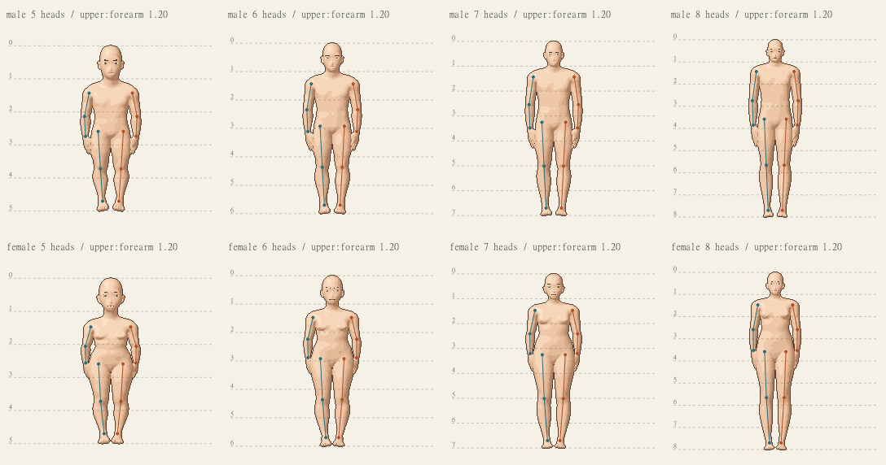

점은 모델이 쓰는 어깨·팔꿈치·손목·고관절·무릎·발목이며, 선은 그 연결을 보여 준다. 피부 외곽선의 극점이나 뼈 전체를 뜻하지 않는다. 위팔/전완 1.20은 이번 기본형에서 선택한 작화 비율이다. 손의 길이와 손목–사타구니 관계는 별도로 다시 비교해야 한다. 연구 화면에서는 관절 표시를 켜거나 끌 수 있다.

## 21. 일본어 손 작화와 얼굴 대비 크기

[CLIP STUDIO 원문 — 哀川空·いしだわかこ](https://www.clipstudio.net/oekaki/archives/149736)

**한 줄:** 손의 덩어리와 얼굴 대비 크기를 먼저 본다.

**한 문장:** 손바닥·엄지·네 손가락을 구분하고 미튼 윤곽 안에서 손가락 길이와 관절의 위치를 구성한다.

**주요 개념:** 손바닥, 엄지 밑동, 손가락 묶음, 관절, 얼굴 대비 크기.

**실제 관찰:** 세 덩어리와 미튼 외곽을 보여 주는 도판, 손과 얼굴을 나란히 비교한 도판을 직접 확인했다. 손과 얼굴의 크기 관계는 작화 점검의 출발점이며 성별로 고정된 인체 법칙이 아니다.

**이번 모델에 적용한 자체 분석:** 11차에서는 등신을 바꾸는 세로 변환이 손에도 그대로 적용됐다. 5~8등신의 손 길이는 남성 약 0.58~1.02, 여성 약 0.52~0.91 머리 단위로 변했다. 이는 골격 길이 조절과 손 자체 크기가 분리되지 않은 구현 문제다. 12차 망가 실험형은 선택한 손 길이 0.56·0.63·0.70·0.77 단위로 손 전체를 균일하게 변형한다. 이 수치는 현재 시안의 조형 선택이며 현실 인체의 표준값이 아니다. 손목 높이도 별도로 조절해 여성의 손끝이 과도하게 높던 현상을 줄였다.

**비교 방법:** 정면 전신에서 손끝의 위치를 보고, 측면 확대에서는 손바닥과 손가락이 같은 비율로 줄었는지 확인한다. 사선에서 몸에 가려지는 현상과 실제 표면의 찌그러짐을 구분한다. 얼굴 대비 크기는 머리 크기를 통일한 화면에서 다시 판단한다.

## 22. Proko 손의 입체 구성

[무료 공개 강의 노트](https://www.proko.com/course-lesson/how-to-draw-hands-from-imagination-step-by-step)

**한 줄:** 손목·손바닥·손가락을 이어지는 입체로 구성한다.

**한 문장:** 손바닥의 오목한 상자와 손가락의 방향, 엄지 밑동, 손목으로 넘어가는 면을 먼저 정한 뒤 세부를 더한다.

**주요 개념:** 입체 단순화, 손바닥 곡면, 손가락 묶음, 엄지 밑동, 손목 전이.

**열람 범위:** 공개 Lesson Notes를 읽었다. 유료 영상과 다운로드를 본 것으로 기록하지 않는다.

**이번 실험의 자체 관찰:** 12차 첫 시안은 손 크기를 줄였지만 손목 아래에 단차가 생겼다. 원인을 추적하니 손가락과 손목 가중치만 묶고 중수골 가중치를 누락했다. 손바닥 일부가 이전 높이에 남아 표면을 잡아당긴 것이다. 중수골을 포함하고 전완 단면을 손목 크기로 부드럽게 연결해 수정했다. 이 실패는 길이 수치만 맞아도 형태 연결이 틀릴 수 있음을 보여 준다.

**남은 작업:** 손끝의 자연스러운 휴식 자세, 엄지와 검지 사이의 벌어짐, 작은 픽셀에서 손가락을 읽는 명암을 더 비교한다. 의도적으로 포즈를 새로 확장하지 않고 기본형 안에서 검토한다.

## 23. 12차 팔·손 교정 전후

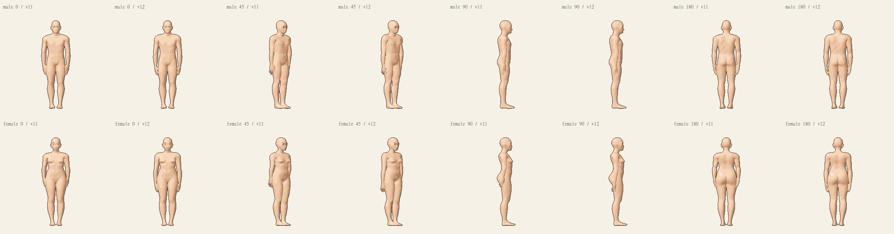

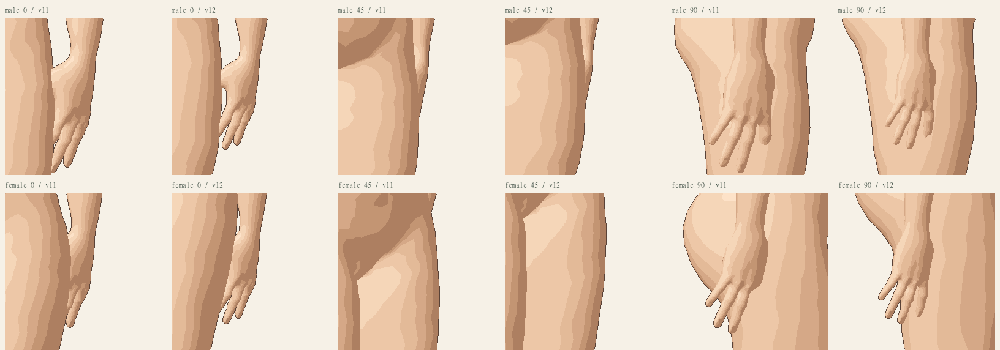

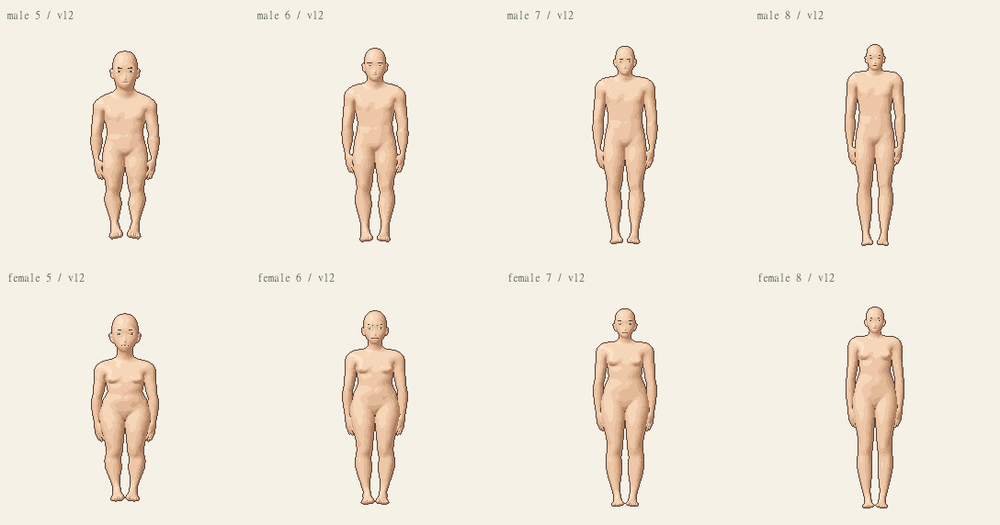

각 쌍의 왼쪽은 11차, 오른쪽은 12차다. 마지막 판은 모두 12차다. 망가 실험형만 팔·손 재배치를 적용하고 해부 구조 중심 선택은 이전 비교 기준으로 유지한다. 표면은 CC0 성인 인체의 변형이며 실제 인체 승인과 미적 완성도 판정은 보류한다.

## 24. 15차 형태와 가려지는 그림자를 분리해서 보기

이번 항목은 외부 자료의 새 요약이 아니라 동일 모델을 이용한 자체 렌더 실험이다. 기존 명암은 면의 방향만 계산했다. 턱 아래·귀 뒤·팔과 몸 사이처럼 다른 부위가 빛을 가리는 관계를 따로 비교했다.

첫 시안에서는 그림자 계산 해상도와 표면 기울기 오차 때문에 피부에 줄무늬가 생겼다. 얼굴 확대의 계산 범위를 머리 주변으로 맞추고 기울기에 따른 오차를 조절해 수정했다. 가려지는 그림자를 넣으면 턱·목 연결이 더 읽히지만, 코·볼의 형태와 색면 배치는 여전히 다듬어야 한다. 그림자로 형태 결함을 감추지 않는다.

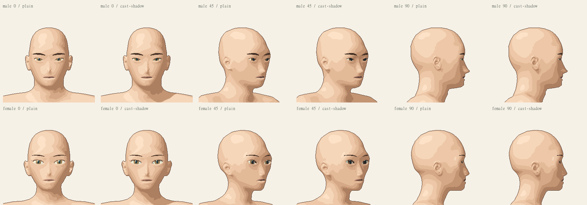

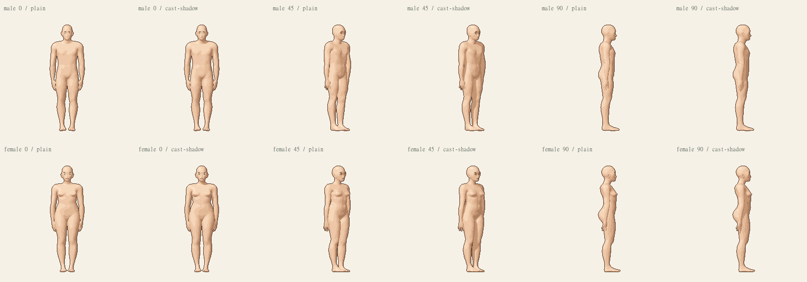

각 쌍의 왼쪽은 기본 명암, 오른쪽은 가려지는 그림자를 추가한 것이다. 실제 비교 화면의 ‘가려지는 그림자 비교’로 켜고 끈다. 기본 표시는 기존과 같고, 이 연구 옵션이 최종 채색 방식으로 채택된 것은 아니다.

검사 4/4: 14차 기본 렌더 기준 16개와 동일, 실제 가림·비가림 구분, 14개 기본형의 896방향 표시, 실루엣 보존과 360도 순환을 확인했다. 모든 그림자의 미적 품질을 승인한 것은 아니다. 브라우저에서 새 체크박스를 직접 조작한 검사는 아직 하지 않았다.

## 25. Proko 대흉근의 부착과 큰 면

[공개 강의 노트](https://www.proko.com/course-lesson/how-to-draw-pecs-anatomy-and-form)

**한 줄:** 가슴의 큰 면은 어깨와 위팔로 이어진다.

**한 문장:** 쇄골·흉골·위팔과 대흉근의 관계를 보고 가슴을 독립된 둥근 덩어리로 처리하지 않는다.

**주요 개념:** 대흉근, 쇄골, 흉골, 위팔, 겨드랑이, 부착 방향.

**실제 관찰:** 공개 Lesson Notes와 남녀 실물 사진 위에 대흉근 범위를 표시한 도판, 부채 비유 도판, 다양한 체격의 작화 도판을 직접 확인했다. 유료 동영상과 3D 뷰어를 열람했다고 주장하지 않는다. 자료의 작화 비유를 세부 해부학의 유일한 정답으로 취급하지 않는다.

**자체 적용 분석:** 기존 기본형은 어깨·가슴·등의 부피 변화가 약해 앞과 사선에서 큰 면이 잘 구분되지 않았다. 근육 전체 변형 A안을 먼저 비교한 뒤 가슴·등·복부의 변화량을 나눈 B안을 만들었다. 가슴을 구 두 개로 붙이거나 표면에 근육 선만 그리지 않고 연결된 인체 표면 안에서 부피를 조절했다. 팔을 들 때 변하는 겨드랑이는 이번 중립 자세 연구의 범위 밖이며 아직 검증하지 않았다.

## 26. Proko 복직근의 층과 얕은 경계

[공개 강의 노트](https://www.proko.com/course-lesson/how-to-draw-abs-anatomy)

**한 줄:** 복부는 같은 크기의 여섯 블록이 아니다.

**한 문장:** 복부의 넓은 면과 중심·바깥 경계, 얕은 가로 구획을 보고 좌우·상하의 차이를 비교한다.

**주요 개념:** 복직근, 복벽의 층, 중심 경계, 가로 구획, 피하지방, 비대칭.

**실제 관찰:** 복벽 근육층 도판, 뼈대 위의 복직근과 경계 도판, 구획의 비대칭 도판을 확인했다. 공개 설명은 보이는 경계가 체격에 따라 달라짐을 다룬다. 이번 연구에서 근육이 선명한 몸을 모든 사람의 기본이나 이상으로 정하지 않는다.

**자체 적용 분석:** 현재는 복부의 큰 면을 유지하며 긴장을 조금 조절하는 기본형이다. 여섯 개의 돌출물을 규칙적으로 붙여 정교한 복근을 완성했다고 주장하지 않는다. 실제 몸통의 면과 작은 픽셀의 명암을 비교하는 단계이며 가로 경계의 섬세한 표현은 더 부족하다. 체형 수량 확대는 보류한다.

## 27. 16차 근육 연결 표면 실험

외부 기준은 기존과 같은 MakeHuman 고정 커밋의 CC0 성인 인체 데이터다. 성인 young(25세) 남녀의 maxmuscle-averageweight 두 파일과 대흉근·광배근·복부 긴장 파일을 추가로 확인했다. 각 파일의 CC0 헤더와 Git blob 해시를 확인했다. 선택한 혼합량은 조형 실험값이며 생물학적 근육량 측정치가 아니다.

A안은 전체 근육 변형만 사용했다. B안은 대흉근·등·복부의 비중을 따로 조절했다. 머리와 관절 좌표는 유지하고 목 위로 변형이 번지지 않게 했다. 망가 실험형에 적용하며 자연형은 기존 해부 구조 비교 기준으로 남긴다. 이전 버전은 체크포인트와 회전표에 보존한다.

B안 초기 검사에서 골반·겨드랑이의 좁은 접힘 여섯 삼각형이 기존 면 방향과 반대로 돌아갔다. 이 부분의 변형을 주변으로 부드럽게 줄여 수정했다. 검사 기준을 완화해서 통과시키지 않았다. 면 방향 보존은 자체 표면 검사이지 실제 인체의 모든 접촉과 움직임을 검증한 것은 아니다.

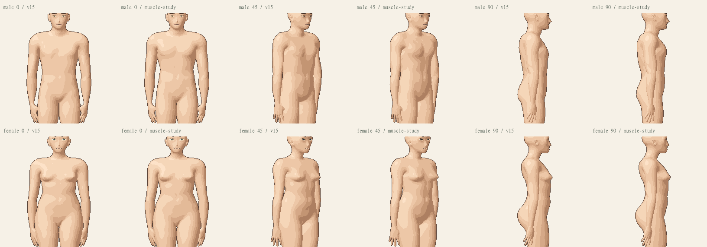

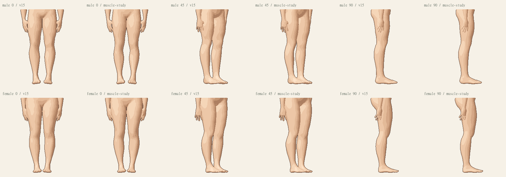

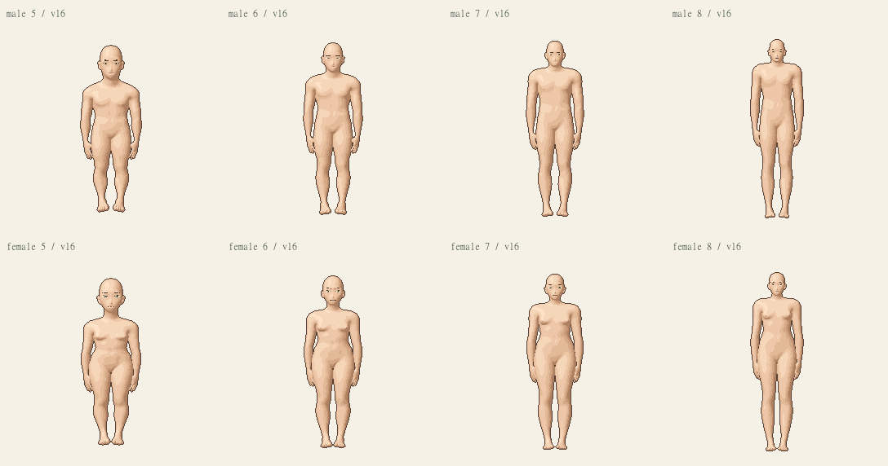

앞의 두 판은 15차와 16차의 쌍이다. 마지막 판은 모두 16차다. 근육의 큰 면을 더 구분할 수 있지만 복근의 섬세함, 여성 가슴–흉곽의 다양한 연결, 얼굴과 전체 조화는 아직 미승인이다. 체형 30종이나 새 콘텐츠를 완료한 것으로 기록하지 않는다.

## 28. Proko 코의 큰 면과 해부학 구조

[공개 강의 노트](https://www.proko.com/course-lesson/how-to-draw-a-nose-anatomy-and-structure)

**한 줄:** 코의 세부 전에 앞·옆·아래 면의 방향을 정한다.

**한 문장:** 콧등·코끝·콧방울의 부피가 고개 회전에 따라 어떻게 가려지는지 확인하고, 콧구멍 선만으로 입체를 대신하지 않는다.

**주요 개념:** 큰 면, 콧등, 코끝, 콧방울, 비중격, 관점에 따른 가림.

**열람 범위:** 무료 강의 노트의 큰 면·해부학·작은 면 설명을 읽고, 큰 면에서 세부로 이어지는 도판과 평면 윤곽·콧구멍 위주 묘사의 오류 도판을 직접 관찰했다. 다운로드한 연골 도판은 이 단계에서 아직 직접 관찰하지 않았으므로 관찰 목록에 넣지 않는다. 영상·유료 자료는 열람하지 않았다.

**자체 적용 분석:** 기존 코의 명암은 작은 밝은 덩어리로 끊겨 콧등과 코끝의 관계가 약했다. 얼굴 전체의 법선을 강하게 평활화한 A안은 볼의 잔무늬는 줄었지만 코까지 흐려졌다. 큰 면을 강하게 반영한 B/C안은 콧등이 선처럼 강조됐다. 눈의 개구부까지 확대한 D/E안은 코와 눈 안쪽의 얇은 면이 이전 표면에 대해 반대로 돌아가는 문제가 생겼다. 확대의 인상만으로 채택하지 않고 기하를 원래대로 보존했다. 이후 안구의 확대도 눈꺼풀과 맞지 않아 되돌렸다. 최종 G안은 기존 표면 좌표·안구 위치·눈꺼풀 관계를 유지하고 명암·홍채·입선만 제한적으로 조절한다. 이는 인체 조형 완성이 아니라 읽기 어려운 면을 정리하는 실험이다. 실제 코와 얼굴의 다양성을 한 종류로 일반화하지 않는다.

## 29. 18차 성인 얼굴 대조

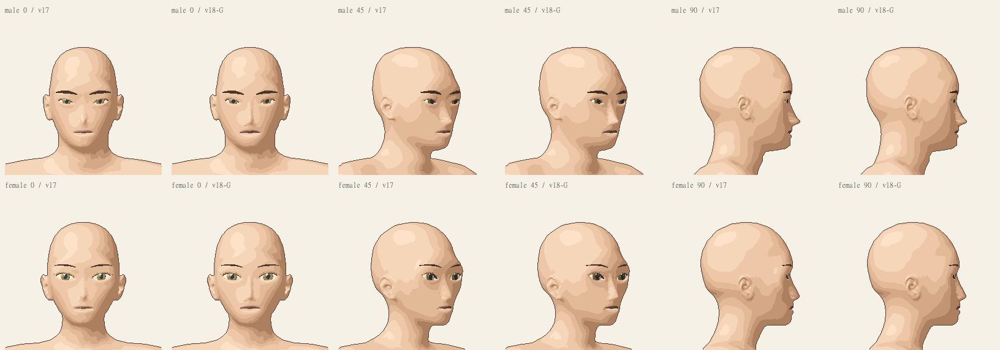

각 쌍의 왼쪽이 17차, 오른쪽이 18차 G 시안이다. 대조 그림의 G 표기는 실험 후보명이다. 코를 지우는 평활화와 과한 콧등 대비, 눈 안쪽 표면 변형, 안구 노출 과잉을 구분해 제외했다. 자연형과 피부 표면 좌표는 유지했다. 코·입 주변의 잔무늬는 줄었으나 목표 참고 그림 수준의 얼굴 조화는 여전히 미달이다. 사용자 승인 없이 몸매 수량이나 콘텐츠 확장으로 넘어가지 않는다.

## 30. 19차 발 아치·손바닥의 가림과 실제 형태 분리

[기존 Proko 발 연구 원문](https://www.proko.com/course-lesson/how-to-draw-feet)

기존 자료를 다시 열어 무료 강의 노트의 큰 덩어리·아치·지방 패드·발가락을 읽고, 발 뼈와 단순화 블록, 안쪽·바깥쪽 면, 발바닥 지지 패드 도판을 직접 보았다. 같은 URL을 새 자료로 중복 집계하지 않는다. 원문의 작화용 단순 비례는 모든 발의 정상 범위로 사용하지 않는다.

**핀포인트한 문제:** 기존 확대 화면의 손은 몸통에 가려지고, 발은 반대쪽 발과 겹쳤다. 특히 옆면만 보고 아치가 없다고 판단하면 이미 있는 입체를 불필요하게 변형할 수 있다. 실제 7등신 표면의 안쪽 중간 높이를 측정하니 남성·여성 시작형에 서로 다른 아치 곡면이 있었다. 측정값은 이 시안의 머리 단위이며 의학적 판정 기준이 아니다. 발 전체의 옆 실루엣에는 바깥쪽 바닥이 함께 보이므로 아치가 항상 빈 구멍으로 표시되어야 하는 것도 아니다.

**구현:** 한쪽 손·발의 기존 면만 분리해 회전하는 관찰 옵션을 추가했다. 원본 좌표와 원래 몸은 변경하지 않는다. 손목·발목 위에 잘라 보이는 경계가 있으며 관찰용으로 화면에 맞춘다. 기본 전신과 손·발 그림 42개는 18차와 같은 이미지 해시를 유지한다. 작은 등신을 포함한 1,792방향의 분리 보기와 8차 비교 기본형 512방향을 검사했다. 검사 결과는 해부학적 자연스러움이나 예술적 승인을 대신하지 않는다.

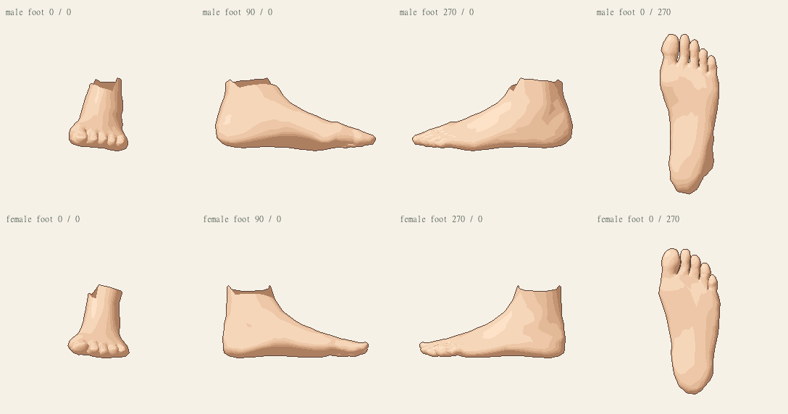

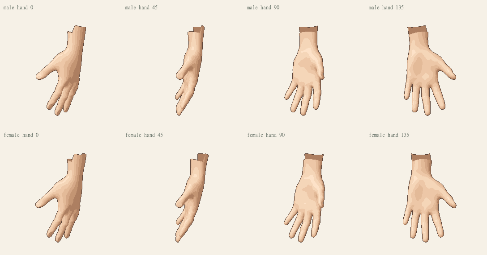

**남은 분석:** 발목을 포함한 전체 자세에서 발바닥의 기울기와 지지점을 대조해야 한다. 손가락의 휴식 자세, 엄지의 벌어짐, 작은 크기의 읽힘도 검토 대상이다. 이번 단계는 가림을 제거한 관찰 도구이며, 손·발 형상을 완성했다고 선언하는 변경이 아니다.

## 31. 20차 발의 누적 기울기와 지지점

19차 분리 관찰 뒤 원래 자세 변환을 다시 읽었다. 위다리에 적용한 좌우 회전이 발에도 누적돼 있었다. 발 관절에서 이를 절반만 되돌린 B와 전부 되돌린 A를 기존 자세와 비교했다. A는 각 발에서 0.15라디안을 반대로 보정한 시안이다.

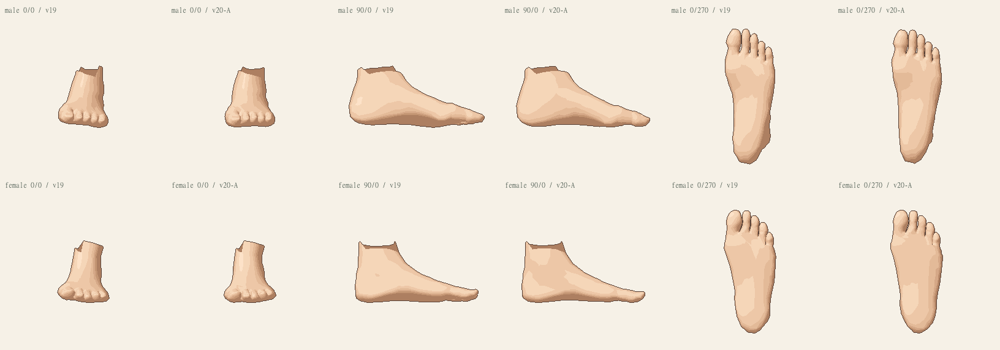

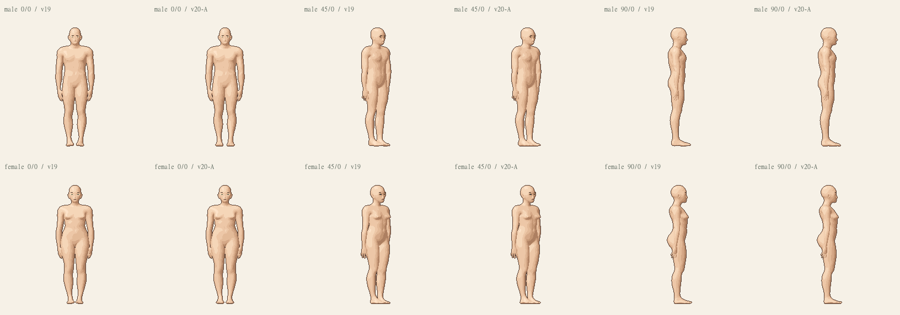

남성 기본형에서 뒤꿈치의 최저 높이는 머리 단위 약 0.021에서 0.0046으로 줄었다. 여성 기본형은 뒤꿈치·앞쪽 지지 구간의 관계를 함께 검토했다. 한 점을 바닥에 붙이기 위해 발 전체를 납작하게 누르지 않았다. 발·발목·종아리 하단의 가중치에 따라 정렬하고 접지 기준을 다시 맞췄다. 이 수치는 해당 정적 작화 시안의 비교값이며 사람의 정상 기준이나 보행 능력 평가가 아니다.

**보존 검사:** 남녀 5~8등신의 상체·얼굴 좌표와 자연형 표시를 그대로 유지했다. 원전 53,512면의 방향, 양발의 바닥 관통과 지지 구간, 손·팔 비례·눈꺼풀 가림도 확인했다. 13개 성인 검사와 14개 회전표 검사가 통과했으며, 손·발 분리 보기 3개 항목도 새 형상에서 다시 검사했다. 사용자 인체 승인은 여전히 없다.

## 32. 여성 흉곽과 가슴의 연결 연구

[Proko: How to Draw Breasts — Form and Motion](https://www.proko.com/course-lesson/how-to-draw-breasts-form-and-motion)

**한 줄:** 가슴은 흉곽 위에 이어지는 부드러운 부피다.

**한 문장:** 대흉근과 지방 조직의 관계, 상부 경사와 하부 곡면을 함께 보며 흉곽에서 분리된 구나 원뿔처럼 만들지 않는다.

**주요 개념:** 흉곽의 곡률, 대흉근, 지방 조직, 상부 전이, 하부 곡면, 자세에 따른 변화.

**열람 범위:** 무료 Notes의 형태와 움직임 설명을 읽었다. 대흉근과 가슴 조직을 실물 위에 겹친 도판 및 옆모습 크기 비교 도판을 직접 보았다. 원문의 다른 자세 사진과 영상은 이번 관찰 목록에 포함하지 않는다. 외부 도판은 공개 자산에 재배포하지 않는다.

**한 페이지 적용 분석:** 현재 옆모습은 상부에서 끝으로 내려오는 경사와 아래쪽 경계가 급하게 꺾여 작은 원뿔처럼 읽혔다. 정면에서는 하부의 어두운 띠가 단단한 판처럼 보였다. 크기를 늘리는 조치는 이 연결 문제를 해결하지 않는다. 같은 성인 기본형의 가슴 끝 돌출, 아래쪽 부피 분포, 단단함을 별개 변수로 분리했다. 각 후보를 같은 카메라·등신·조명으로 비교한 뒤 흉곽에 붙는 외곽을 유지하면서 내부 곡면만 완화했다. 가슴 자체의 부피와 대흉근을 하나의 근육 덩어리처럼 해석하지 않는다. 자세와 중력에 따른 형태 변화는 연구 과제로 남겼으며 정적인 조형 수정으로 움직임을 구현했다고 주장하지 않는다. 이 시안은 성인 여성 한 종류의 기본틀이며 전체 여성의 대표 체형이나 해부학적 정상 기준이 아니다.

## 33. 가슴 작화 오류와 현재 모델의 대응

[Proko: Common Mistakes of Drawing Breasts](https://www.proko.com/course-lesson/common-mistakes-of-drawing-breasts)

**한 줄:** 같은 공 두 개를 붙이는 방식에서 벗어난다.

**한 문장:** 상부와 하부의 서로 다른 곡률, 흉곽 위의 배치와 조직 두께를 관찰하고 형태를 한 가지 공식으로 고정하지 않는다.

**주요 개념:** 구형·원뿔형 단순화의 한계, 상부 전이, 하부 충만감, 조직 두께, 개체 차이.

**열람 범위:** 무료 Notes의 흔한 형태 오류와 두께 설명을 읽었다. 원문의 배치 예시를 모든 인체에 적용할 수치나 각도 규칙으로 사용하지 않았다. 유료 자료·영상 열람 없음.

**한 페이지 적용 분석:** 기존 모델의 문제는 두 종류다. 실루엣에는 급한 꺾임이 있고, 내부에는 작은 명암 띠가 덩어리를 잘게 나눈다. 실루엣과 법선을 동시에 크게 바꾸면 어느 조치가 효과를 냈는지 알 수 없어 분리 실험했다. A/B는 기존 변형 값만 조절해 전신에서 차이가 작았다. C는 아래쪽 분포와 부드러운 형태를 더했으나 끝의 각짐이 남았다. D/E는 바깥 연결 경계를 고정하고 안쪽 곡면을 순차 완화했다. F는 명암까지 강하게 평활화해 아래 경계의 읽힘이 약해졌다. G는 E의 곡면과 더 적은 명암 평활화를 결합했다. 이 선택은 한 가지 기본형의 수정이며 다양한 크기·형태의 완성이나 사용자 승인을 뜻하지 않는다. 이후 다른 체형은 기준형의 연결과 전체 조화가 충분해진 뒤 별도로 연구한다.

## 34. 21차 성인 가슴·흉곽 곡면 대조

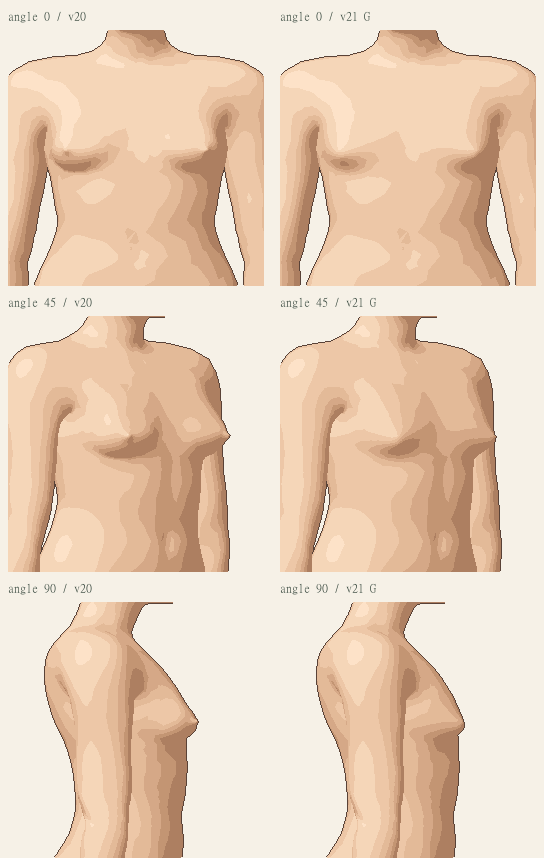

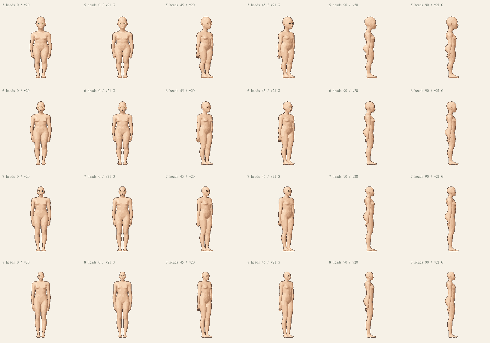

각 쌍은 이전 20차와 실제 실행 코드의 21차 G다. 7등신 확대는 같은 카메라를 사용한다. 곡면 외곽을 고정한 12회 국소 평활화와 3회 법선 완화를 사용했다. CC0 성인 변형 자료 세 개의 고정 해시·가중치와 자체 처리 범위는 출처 문서에 기록했다. 299개 정점만 이동했으며 원전 머리 단위 최대 이동은 약 0.078이다. 이 숫자는 설계 변경량이고 사람의 정상 범위를 의미하지 않는다.

**검증:** 5~8등신 표면에서 새로 반대로 돌아간 면은 없었다. 가슴 외 피부 좌표, 16개 얼굴 표시, 12개 남성·자연형 전신 표시가 20차와 일치했다. 성인 검사 14개와 남녀 2~8등신 회전표 검사 14개가 통과했다. 회전표는 45도 간격 좌우·상하 64방향이며 총 896개 그림이다. 그림 생성·잘림 검사는 미적 완성도나 모든 자세의 해부학 검증을 대신하지 않는다.

**보류:** 어깨에서 겨드랑이로 이어지는 접힘, 복부·골반의 큰 면, 얼굴 전체의 조화는 여전히 검토 대상이다. 특히 작은 원본 크기에서는 형태 차이가 약하다. 사용자 미승인 상태를 유지하고 몸매 수량·의상·동작 확장은 진행하지 않는다.

## 35. 어깨의 앞·옆·뒤 면과 겨드랑이의 접힘

[Proko: 삼각근의 구조](https://www.proko.com/course-lesson/how-to-draw-deltoids-anatomy-for-artists/) · [기존 일본어 팔 연구 다시 보기](https://www.clipstudio.net/oekaki/archives/164836)

**한 줄:** 삼각근은 위팔 위에 붙인 공이 아니다.

**한 문장:** 쇄골·견봉·견갑골에서 위팔로 이어지는 세 부분의 방향을 보고 어깨의 큰 면과 겨드랑이의 전이를 구분한다.

**주요 개념:** 전면·측면·후면, 부착선, 위팔 방향, 비대칭 곡면, 큰 면 우선.

**열람:** 무료 Notes의 부착·세 부분·형태 설명과 도판 세 개를 직접 보았다. 일본어 팔 연구의 뼈 기준점·근육 도판 두 개도 다시 확인했다. 일본어 문서는 기존 등록 URL이므로 중복 집계하지 않는다. 영상·유료 자료는 보지 않았다.

**적용 분석:** 현재 기본형은 앞과 뒤의 겨드랑이 홈이 강한 동심원 같은 명암으로 읽혔다. 자연형·작화형·근육 교정형을 같은 시점으로 비교하니 원전 자세에서도 홈이 나타났다. 이를 근육 부족으로 단정하지 않았다. 어깨 주위에만 8회·20회 곡면 평활화를 적용한 A/B를 만들었지만, 홈은 충분히 좋아지지 않고 어깨 덩어리만 둥글어지는 경향을 보였다. 따라서 두 안 모두 채택하지 않았다. 원문 도판의 큰 면과 근육 연결을 관찰하는 것이 표면을 무조건 매끈하게 만드는 근거가 되지는 않는다. 팔을 내린 정적 자세의 접힘과 광원에 따른 명암을 구분하는 추가 연구가 필요하다.

## 36. 어깨뼈의 기준점과 전신 연결

[Proko: How to Draw the Shoulder Bones](https://www.proko.com/course-lesson/how-to-draw-the-shoulder-bones)

**한 줄:** 어깨의 방향은 흉곽 위의 뼈 기준점에서 읽는다.

**한 문장:** 흉곽의 큰 형태를 먼저 두고 쇄골·견봉·견갑골의 위치와 가림을 확인한 뒤 근육 면을 연결한다.

**주요 개념:** 흉곽, 쇄골, 견봉, 견갑골, 단축, 부착과 겹침.

**열람:** 무료 Notes의 앞·뒤 작화 설명을 읽었다. 이 문서의 도판은 이번 단계에서 직접 열어 관찰하지 않았으며 영상·유료 예제도 미열람이다.

**적용 분석:** 현재 어깨를 둥근 덩어리로만 다듬으면 목에서 어깨로 넘어가는 기울기와 팔로 내려가는 면을 잃을 수 있다. 몸통과 팔의 접점을 한 점으로 취급하지 않고 쇄골과 견갑골이 흉곽을 감싸는 관계를 기준으로 검토해야 한다. 원문의 한 모델에 대한 작화용 치수와 비례는 모든 사람에게 적용하는 정상 수치로 옮기지 않았다. 이번 수정에서는 어깨뼈와 관절 위치를 바꾸지 않는다. 정적인 회전 화면은 신체 전체를 카메라에 대해 회전시키는 것이며 팔을 올리고 내릴 때 견갑골이 움직이는 동작 구현과 다르다. 그 기능은 현재 보류 상태다.

## 37. 22차 성인 귀와 눈·입 구분

[기존 귀 구조 연구](https://www.proko.com/course-lesson/how-to-draw-ears-anatomy-and-structure)를 기준으로 귀둘레·맞둘레·귓불이 작은 얼굴에서 구별되는지 다시 보았다. 이번에는 새 자료로 중복 집계하지 않는다.

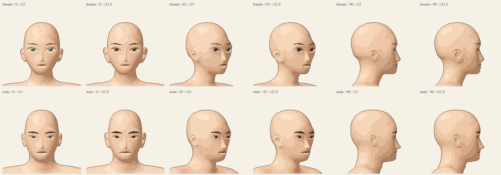

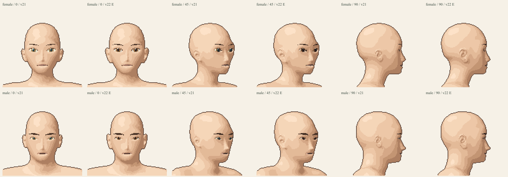

**후보:** C는 원전 귀 크기 변형 0.35, D는 0.65다. D가 옆면의 내부 구조를 읽는 데 더 나아 E의 바탕으로 사용했다. E는 성인 작화형에만 흰자·갈색 홍채·짙은 동공을 구분하고, 눈썹·윗눈꺼풀의 선 굵기 및 입 폭을 조절했다. 기존 청록 계열 동공과 녹색 기가 있는 흰자가 겹쳐 눈의 중심이 약하게 보이던 점을 수정했다. 얼굴의 모든 부분을 완성했다고 판단하지 않는다.

**검증과 한계:** 귀 원전 데이터의 CC0 표기와 두 파일 해시를 확인했다. 원전에서는 양쪽 귀와 부착 주변 1,016개 정점이 각 성별에서 움직인다. 실행 시의 얼굴 평활화가 인접 영역까지 전달되므로 실제 변경 정점 수는 더 많다. 5~8등신 남녀를 이전 실행 표면과 비교해 새로 뒤집힌 면이 없음을 확인했다. 몸 좌표 22개 사례, 자연형·작은 등신 이미지 14개는 이전과 일치한다. 성인 검사 15개와 전체 회전표 검사 14개가 통과했다. 귀의 뒷면·부착, 얼굴의 조화와 낮은 해상도의 읽힘은 계속 검토한다. 사용자 승인은 아직 없다.

## 38. 작은 등신의 몸통·손 연결 재검토

23차 작은 기본형의 자료별 분석과 실제 전신·손 대조는 [일본 등신 연구 32~34절](anime.html#section-32)에 기록했다. 작은 몸의 연결·손 분리 관찰을 수정했으며 성인 전신 16개 렌더와 작은 얼굴 18개는 보존했다. 성인 체형 세부를 작은 중성 몸에 옮기지 않았다.

## 39. 등신 변화에 따른 몸통·사지 두께 점검

24차의 자료 분석, 실패 수정, 남녀 5~8등신 실제 비교 그림은 [일본 등신 연구 35~36절](anime.html#section-35)에 기록했다. 같은 머리 크기에 몸의 길이만 줄어드는 문제를 폭·깊이·손 길이 조율로 수정했다. 목 전이를 분리해 얼굴 보존 실패를 해소했다. 8등신·자연형·작은 기본형은 보존했으며 인체 승인 전 상태다.

## 40. 대흉근과 삼각근 사이의 연결 재검토

[Proko — How to Draw Pecs – Form](https://www.proko.com/course-lesson/how-to-draw-pecs-form)

**한 줄:** 어깨 앞의 홈은 근육 부착과 큰 면 속에서 판단한다.

**한 문장:** 흉곽을 감싸는 대흉근이 위팔 쪽으로 모이고 삼각근 아래로 이어지는 구조를 확인해, 어깨의 모든 홈을 지우는 식의 수정을 피한다.

**주요 개념:** 쇄골부, 흉골부, 상완 부착, 외측 경계, 큰 면, 접힘.

**열람:** 무료 Notes를 읽고 기존에 보관한 대흉근 설명에서 사용한 방향선이 있는 부채 사진과 삼각근 전면 도해를 다시 직접 보았다. 프리미엄 자료·영상 전체를 열람했다고 주장하지 않는다.

**한 페이지 적용 분석:** 현재 시안은 겨드랑이 위쪽의 어두운 홈이 둥근 어깨와 끊겨 보여 그 원인을 분리했다. 표면을 평활화한 이전 후보는 충분히 개선되지 않았다. 이번 C/D에서는 앞쪽의 좁은 홈을 국소적으로 메웠지만 주변의 곡률 차이가 커져 어깨 앞에 부풀어 오른 경계가 생겼다. 이런 결과는 자연스러운 근육 연결을 만들었다고 보기 어렵다. 두 후보 모두 실행 코드에서 제외했다. 실제 해부 구조에 필요한 함몰과 표현 방식이 과장하는 경계를 구분하는 것이 다음 판단의 기준이다.

## 41. 관절 부피 보존 방법의 시험과 미채택

[Ladislav Kavan — SIGGRAPH 2014 Direct Skinning Methods](https://skinning.org/direct-methods.pdf) · [저자 설명](https://users.cs.utah.edu/~ladislav/dq/)

**한 줄:** 회전을 단순히 섞으면 관절 부근의 부피가 줄 수 있다.

**한 문장:** 이중 사원수 변형은 일부 관절 수축을 줄이지만 구부리는 부분이 부풀 수 있으므로, 현재 모델에서 효과를 확인한 뒤 선택해야 한다.

**주요 개념:** 강체 변환, 가중치, 정규화, 부호 선택, 부피 감소, 부풀음.

**열람:** 저자 설명과 강의 노트의 선형 변형·이중 사원수·한계 부분을 읽었다. 외부 라이브러리 구현 코드를 가져오지 않고 사원수 연산을 자체 작성해 비교했다. 웹 도구의 저자 사이트 접근은 시간 초과였지만 일반 요청으로 공개 본문을 확인했고, 강의 PDF는 웹 도구에서 열람했다.

**한 페이지 적용 분석:** 기존 자세와 가중치를 유지하고 변형 연산만 바꿨다. 알려진 축 회전·이동 15개를 행렬 계산과 대조해 최대 오차 약 5.44e-16을 확인했다. 어깨 부근에만 차이를 적용한 A/B에서 원전 변위는 남성 최대 약 0.0177, 여성 약 0.0123 머리 단위였다. 실제 확대 결과에서 필요한 개선이 작아 채택하지 않았다. 연산이 수학적으로 맞는 것과 그림의 문제를 해결하는 것은 별개의 판단이다. 이 시험을 근거로 겨드랑이 문제 전체를 관절 수축 탓이라고 단정하지 않는다.

## 42. 피부의 부드러운 면과 명암 경계

[Proko — Intro to Edges](https://www.proko.com/course-lesson/intro-to-edges)

**한 줄:** 둥근 부피와 급한 모서리는 다른 명암 경계가 필요하다.

**한 문장:** 피부의 둥근 면이 모두 단단한 경계처럼 보이지 않도록 명암 전이를 조절하면서 실루엣과 중요한 특징은 구분되게 둔다.

**주요 개념:** 경계의 강약, 값의 대비, 면 전환, 형태 그림자, 투영 그림자.

**열람:** 공개 Lesson Notes를 읽었다. 이번 문서의 영상·도판은 직접 관찰하지 않았다.

**한 페이지 적용 분석:** 현재 피부는 9색 램프를 사용해 부드러운 면에서도 넓은 계단 모양 색 경계가 반복됐다. 이 경계가 어깨·목·광대의 곡률을 지나치게 끊어 보이게 하는지 확인하려고 같은 기하에 17색 E와 25색 F를 적용했다. F가 얼굴·몸통의 부피 연결을 더 자연스럽게 보여 채택했다. 기존 색의 범위와 빛 방향을 유지하고 중간색을 추가한 자체 작화 선택이다. 픽셀을 흐리게 처리하거나 큰 이미지를 축소하지 않았으며, 128px 원본에서도 확인했다. 둥근 면을 읽기 쉽게 만든 조정이지 골격·근육이 완성됐다는 의미는 아니다.

## 43. 25차 실제 피부 표현 대조와 보존 검사

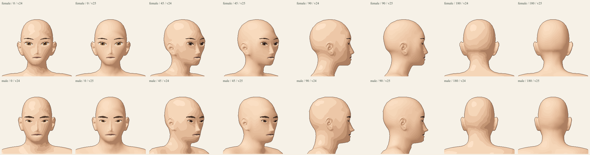

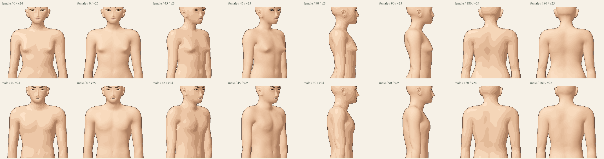

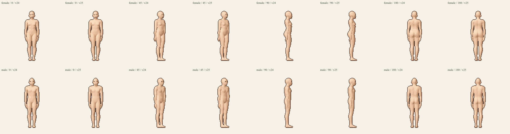

각 쌍의 왼쪽은 24차, 오른쪽은 25차의 실제 실행 결과다. 첫 두 그림은 각 칸 원본 256px, 마지막은 원본 128px를 정수 배율로 표시했다. 얼굴과 몸은 같은 25색 피부 램프를 사용하며 각 그림이 모든 25색을 반드시 사용한다는 뜻은 아니다.

**검증:** 피부 표현 검사 4/4. 기본형 22개 사례의 정점·법선·삼각형, 자연형·작은 기본형 14개 실제 이미지, 성인 남녀 512방향의 픽셀 실루엣이 24차와 일치한다. 기존 재질은 보존했고 새 피부의 3색 계열은 명도가 순서대로 증가한다. 회전표도 남녀 2~8등신 14개·896방향에서 확인했다.

**미완료:** 골격이나 근육 표면은 이번 채택안에서 바꾸지 않았다. 어깨·겨드랑이 구조와 얼굴의 코·입·턱 연결, 작은 원본에서의 세부는 추가 연구 대상이다. 사용자 인체 승인을 받기 전까지 몸매 수량·콘텐츠 확장은 보류한다.

## 44. 입술의 큰 면과 중앙·양옆 부피

[Proko — How to Draw Lips: Anatomy and Structure](https://www.proko.com/course-lesson/how-to-draw-lips-anatomy-and-structure)

**한 줄:** 입술은 얼굴 앞에 그은 평평한 선이 아니다.

**한 문장:** 치열을 감싸는 전체 부피 위에서 윗입술·아랫입술의 방향과 중앙·양옆의 작은 부피를 함께 본다.

**주요 개념:** 치열의 곡면, 위아래 면의 방향, 윗입술 중앙, 입꼬리, 아랫입술 아래 전이.

**열람:** 무료 Notes를 읽고 면 방향의 계단 도해, 작은 부피 구분 도해, 입술 아래 연결 도해 세 개를 직접 관찰했다. 영상과 유료 자료는 보지 않았다. 재접속 때 웹 도구가 시간 초과됐지만 앞서 확보한 공개 원문과 도해를 확인했다.

**자체 적용 분석:** 25차의 입은 주변 피부와 다른 명암 규칙을 써서 얇고 밝은 테두리가 나타났다. 얼굴 법선의 평활화도 입술의 면 차이를 약하게 만들었다. A는 피부 계열에 맞춘 25단계 입술 색을 적용했고 B는 입 주변에 한정해 표면에서 계산한 원래 법선을 일부 되살렸다. C는 좁은 타원으로 제한하던 색 영역을 수정해 윗입술의 중앙·양옆과 더 둥근 아랫입술 범위를 구분했다. D에서는 닫힌 입의 중앙 굴곡도 조정했다. 3차원 피부 좌표는 그대로 두고 명암·색 범위·입선만 바꿨다. 모든 사람에게 동일한 입술 비례를 적용한다는 뜻이 아니며, 아직 하나의 성인 시작형 연구다.

## 45. 일본 작화 자료의 입꼬리와 생략

[MediBang / mozukuni — すぐにクオリティアップ！口を魅力的に描く簡単テクニック](https://medibangpaint.com/use/2020/12/techniques-for-drawing-attractive-lips/)

**한 줄:** 작은 입에서도 입꼬리와 아랫입술의 단서를 고른다.

**한 문장:** 선을 많이 추가하기보다 입꼬리의 깊이와 위아래 입술 사이의 관계가 작은 크기에서 읽히는지 비교한다.

**주요 개념:** 입꼬리 그림자, 윗입술의 부피, 아랫입술 선, 선 간격, 생략 수준.

**열람:** 일본어 본문의 입 그림자·입술 설명을 읽고 윗입술 그림자 도해와 아랫입술 선 비교 도해 두 개를 직접 보았다. 글·그림의 mozukuni 표기를 확인했다.

**자체 적용 분석:** 닫힌 입을 일정한 굵기의 직선처럼 만들면 표정과 부피를 잃기 쉽다. 다만 작은 픽셀에서 굴곡이나 그림자를 과하게 추가하면 입이 열린 것처럼 보이거나 잡음이 될 수 있다. 이번 D의 입선은 표면 깊이를 따라 놓고 중앙의 내려오는 부분과 양옆을 작게 구분했다. 정면뿐 아니라 45도·90도와 위아래 시점에서 확인했다. 128px에서는 입꼬리의 점과 중앙선이 간략하게 남고, 256px에서만 더 많은 면이 읽힌다. 이 차이는 해상도에 따른 결과이며 확대 그림만으로 작은 크기의 완성도를 판단하지 않는다. 입을 벌리거나 웃는 애니메이션은 현재 범위에 넣지 않았다.

## 46. 26차 실제 입술 대조와 보존 검사

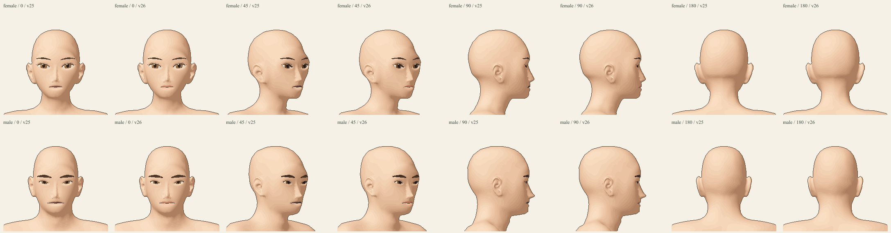

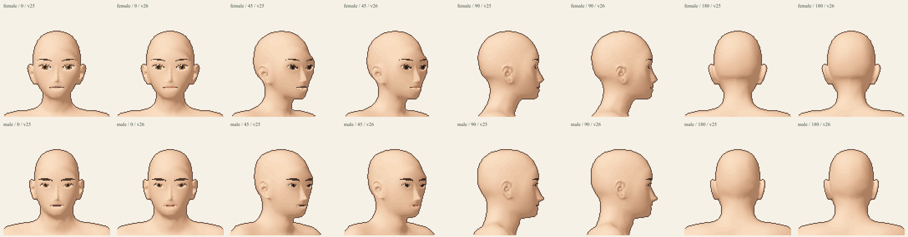

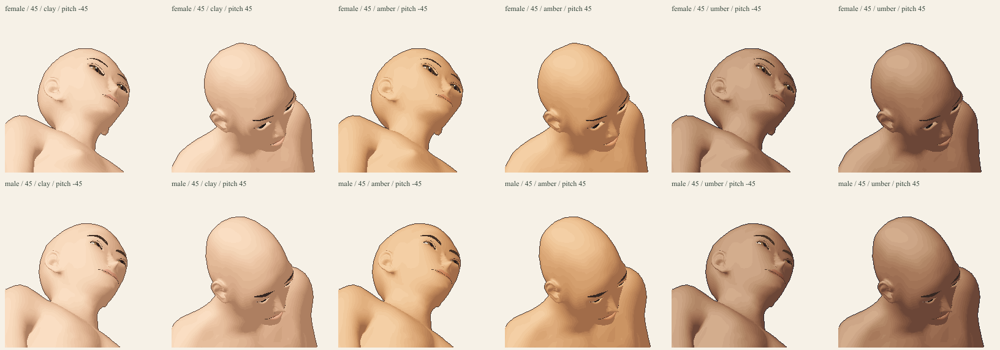

첫 두 그림은 각 쌍의 왼쪽이 25차, 오른쪽이 26차 D다. 마지막은 모두 26차의 실제 코드 결과다. 입술만으로 얼굴의 조화를 완성했다고 판단하지 않는다.

**검증:** 입술 검사 5/5. 남녀 5~8등신의 피부 좌표·전체 삼각형, 입 주변 밖의 법선과 눈·눈썹, 자연형·작은 기본형 14개 이미지 및 기존 재질을 보존했다. 국소 법선은 단위 길이와 이전 방향에 대한 내적을 검사했다. 얼굴 위아래·사선 288개 렌더와 전신 회전표 14개·896방향도 확인했다. 확대 화면의 어깨가 프레임 밖으로 나가는 것을 처음 검사에서 머리 잘림으로 오인했다. 이를 머리 정점을 실제 화면에 투영해 경계를 확인하는 검사로 바로잡았다.

**한계:** 입꼬리의 작은 점과 얼굴의 전체 조화, 눈의 크기·눈꺼풀 연결은 남은 검토 대상이다. 정적인 회전 검사를 해부학적 완성이나 사용자 승인으로 해석하지 않는다. 브라우저 클릭·저장 조작과 운영 웹앱 통합 배포는 이번 단계에서 확인하지 않았다.

## 47. 안구와 눈꺼풀의 부피·가림

[Proko — How to Draw Eyes: Anatomy and Structure](https://www.proko.com/course-lesson/how-to-draw-eyes-anatomy-and-structure)

**한 줄:** 안구의 크기와 눈꺼풀 사이로 보이는 크기를 구분한다.

**한 문장:** 안와 안의 안구를 눈꺼풀이 감싸고, 회전에 따라 홍채·동공과 눈 안쪽이 가려지는 관계를 유지한다.

**주요 개념:** 안와, 눈썹뼈, 구면, 눈꺼풀 두께, 비대칭 면, 측면 단축, 가림.

**열람:** 무료 Notes의 구조·배치·눈꺼풀·홍채·동공 설명을 읽었다. 실제 눈 사진과 눈꺼풀 면을 대조한 도해, 옆 안와 도해, 동공 위치 오류 도해 세 개를 직접 보았다. 영상 전체나 유료 예제는 보지 않았다.

**자체 적용 분석:** 현재 얼굴의 눈은 특히 남성 정면에서 좁은 틈처럼 보여 형태를 읽기 어려웠다. 안구만 앞에 크게 붙이는 대신 눈 주변의 실제 피부를 제한된 구간에서 펼치는 방법을 시험했다. A/B는 세로·가로 확대량이 다르며, 면 방향이 역전되지 않는지를 이전 표면과 비교했다. B는 흰자가 과하게 드러나 놀란 표정처럼 보였다. C/D는 각 확대안에 홍채 크기를 맞췄고, 더 작은 C를 바탕으로 E의 윗눈꺼풀 선을 조정했다. 안구의 중심은 그대로 유지했다. 원문의 작화용 비례나 전형적인 특징은 모든 사람의 정상 형태로 일반화하지 않는다.

## 48. 27차 눈 개구부·눈썹 곡면 연결

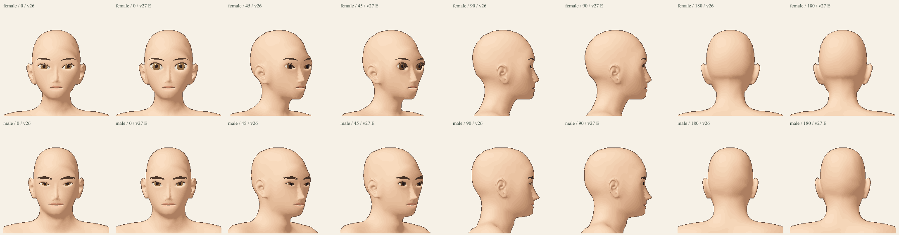

각 쌍의 왼쪽은 26차, 오른쪽은 27차 E다. 일본어 작화 자료와 서양 작가의 일본풍 연구 분석은 [일본 연구 39~40절](anime.html#section-39)에 기록했다.

**선택 근거:** 큰 확대보다 작은 확대와 홍채 조합이 현재 얼굴에서 안정적이었다. 곡면이 달라지면서 눈썹의 일부가 피부에 묻혀 끊겼다. 눈썹을 통째로 앞으로 띄우지 않고 폭 방향의 표면 조각을 더 나눠 피부를 따라가게 했다. 같은 방식으로 작화형의 눈꺼풀 선도 표면을 더 촘촘하게 따른다. 자연형의 분할은 유지했다.

**검증:** 눈 검사 5/5. 남녀 5~8등신 214,048면의 방향을 이전과 비교해 새 역전이 없었고, 눈 주변 밖의 표면 좌표와 전체 면 목록을 보존했다. 자연형·작은 기본형 이미지 14개가 일치한다. 안구 위치 유지, 정면·사선·측면 노출 및 뒷머리 가림, 얼굴 288개 시점의 머리 경계를 확인했다. 전신 회전표 14개·896방향도 검사했다.

**전체 조화:** 전신 5~8등신의 정면·사선·측면·후면을 실제 256px로 다시 보았다. 확대 얼굴의 개선이 작은 전신 화면에서 동일한 정도로 드러나지는 않는다. 어깨·겨드랑이와 다리·발의 연결, 두상과 얼굴 조화는 여전히 검토 대상이다. 자기 교차가 전혀 없다는 증명이나 미적 승인은 아니다. 브라우저 클릭·저장 및 운영 통합 배포는 이번 단계에서 미확인이다.

## 49. 다리 뼈의 기준점과 발목 높이 차이

[Proko — How to Draw Legs: Bone Anatomy for Artists](https://www.proko.com/course-lesson/how-to-draw-legs-bone-anatomy-for-artists)

**한 줄:** 다리의 관절과 뼈 기준점은 근육 부피와 별도로 확인한다.

**한 문장:** 대퇴골·무릎뼈·정강뼈·종아리뼈의 연결을 기준으로 다리 흐름과 안팎 발목의 높이 차이를 대조한다.

**주요 개념:** 넙다리 기울기, 무릎뼈, 정강뼈 앞면, 안팎 발목, 기준점과 연부조직.

**열람:** 무료 Notes의 뼈 구조·관절·발목 설명을 읽고 발목 뼈의 높이 차이와 단순 입체 도해를 직접 보았다. 별도 무릎 강의는 유료 전용 소개만 확인했으므로 상세 내용을 읽은 자료로 집계하지 않는다.

**자체 적용 분석:** 현재 다리에는 관절과 접지가 이미 있으나 작은 전신 화면에서는 무릎과 종아리가 하나의 긴 면처럼 보인다. 이 문제를 해결하려고 뼈 위치까지 임의로 이동시키면 전체 비례와 발바닥 지지 상태가 바뀔 수 있다. 이번에는 관절 좌표·기존 발 형상을 고정한 채 허벅지와 종아리의 부피만 분리해 비교했다. 원문 작화용 길이와 각도를 모든 사람의 정상 수치로 사용하지 않았다. 발목의 안팎 높이는 대칭인 장식 두 개로 만드는 문제가 아니라 원래 표면과 여러 시점의 가림 속에서 검토해야 한다.

## 50. 종아리의 두 머리와 아킬레스건 연결

[Proko — How to Draw the Calf](https://www.proko.com/course-lesson/how-to-draw-the-calf-anatomy-for-artists/)

**한 줄:** 종아리는 좌우가 같은 타원 하나가 아니다.

**한 문장:** 안쪽·바깥쪽의 다른 높이와 큰 부피가 아래의 좁아지는 힘줄 구간으로 이어지는 흐름을 본다.

**주요 개념:** 장딴지근, 가자미근, 안팎 높이 차이, 근복과 힘줄, 뒤꿈치 연결.

**열람:** 무료 Notes를 읽고 실물 종아리 사진과 근육 도해를 나란히 둔 자료, 여러 실물 다리와 윤곽을 비교한 자료 두 개를 직접 보았다. 긴장·이완의 차이는 읽었으나 이번에 움직임을 구현하지 않았다.

**자체 적용 분석:** 27차는 종아리 부피가 비교적 평평하게 이어져 정강이와 뒤쪽 근육의 구분이 약했다. A/B에서 허벅지와 종아리를 함께 늘리니 B는 허벅지가 필요 이상으로 두꺼워졌다. 두 구간의 값을 분리한 C/D를 다시 비교했다. 원전 변형은 근육의 크기와 표면을 함께 바꾸므로 그 자체를 해부학 정답으로 간주하지 않았다. 작은 증가량을 선택해 기존 비례와 발을 유지했다. 내측·외측의 세밀한 분리와 긴장 때의 표면 변화는 여전히 남아 있다.

## 51. 정강이의 면과 발목 전이

[Proko — How to Draw the Lower Leg](https://www.proko.com/course-lesson/how-to-draw-the-lower-leg-anatomy-for-artists)

**한 줄:** 정강이 앞면과 뒤쪽 종아리의 단면은 다르게 읽혀야 한다.

**한 문장:** 뼈가 드러나는 비교적 평평한 면과 주변 근육 부피가 아래에서 힘줄로 좁아지는 관계를 대조한다.

**주요 개념:** 정강뼈 내측 면, 앞정강근, 가쪽 구간, 발목 앞 경사, 단면.

**열람:** 공개 Notes의 다섯 구간·단면·발목 전이 설명을 읽고 근육과 단순 단면을 비교한 도해 한 개를 직접 보았다. 유료 확장·동영상 전체는 미열람이다.

**자체 적용 분석:** 정강이를 원통으로만 처리하면 사선에서 앞면과 종아리가 같은 부피처럼 보인다. 반대로 선을 여러 개 그어 나누면 작은 그림에서 과한 근육 줄무늬가 된다. 현재 수정에서는 기존 면의 방향과 완만한 부피 차이가 살아나는지 256px·512px로 비교했다. 발목 아래는 변화시키지 않아 이전 접지 교정과 발가락을 유지했다. 이 선택으로 모든 발목 표면을 개선했다고 주장하지 않는다. 512px는 실제 새 원본 렌더이며 기존 작은 그림을 부드럽게 확대하는 방식이 아니다.

## 52. 허벅지 안쪽·바깥쪽과 무릎 위의 연결

[Proko — How to Draw Legs: The Quad Muscles](https://www.proko.com/course-lesson/how-to-draw-legs-the-quad-muscles)

**한 줄:** 무릎 위 근육의 끝은 같은 높이의 둥근 고리가 아니다.

**한 문장:** 안쪽과 바깥쪽의 서로 다른 부착 높이, 가운데 힘줄 면과 무릎뼈의 관계를 보고 큰 부피부터 구성한다.

**주요 개념:** 안쪽넓은근, 가쪽넓은근, 넙다리곧은근, 넙다리네갈래근힘줄, 비대칭 연결.

**열람:** 무료 Notes의 네 근육·비대칭·큰 면·개별 부피 설명을 읽고 비대칭 흐름 도해와 실물 무릎 위 내측 부착 도해 두 개를 직접 보았다.

**자체 적용 분석:** 기존의 무릎 위는 큰 윤곽은 있으나 연결 위치의 읽힘이 약했다. 근육 변형을 크게 적용한 B는 부피 증가가 앞서 기본형의 인상이 바뀌었다. C2는 종아리보다 허벅지의 증가량을 낮춰 무릎 위 연결을 제한적으로 강조했다. 선택 값은 남성 상부 0.25·하부 0.50, 여성 상부 0.10·하부 0.25로, 자체 모델의 시안 값이다. 근육량이나 실제 인체의 수치로 해석하지 않는다. 골격과 연부조직의 구분이 작은 크기에서도 충분한지는 계속 검토한다.

## 53. 28차 다리의 부피 분리와 512px 관찰

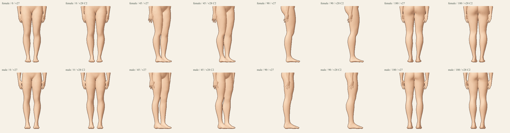

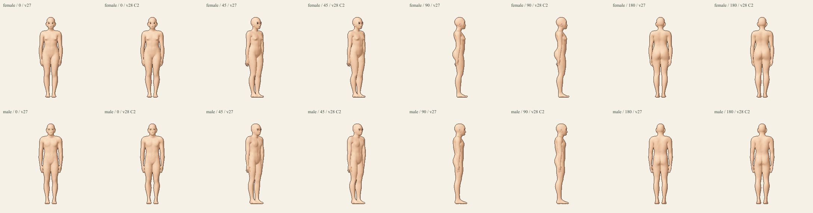

각 쌍의 왼쪽이 27차, 오른쪽이 실제 실행 코드의 C2다. 그림 칸의 원본은 256px다. 512px 관찰은 연구 화면의 원본 크기 선택에서 사용할 수 있다. 화면 표시도 정수 배율로 하고 넓은 그림은 가로로 이동해 볼 수 있게 했다.

**실패와 선택:** 초기 C/D에서 이미 가중한 변경점에 기존 A의 가중치가 다시 곱해지는 실험 오류를 발견했다. C2/D2로 바로잡아 다시 렌더했고 C2를 선택했다. 잘못된 초기 C/D의 결과를 최종값으로 집계하지 않았다.

**검증:** 다리 검사 5/5, 전신 회전표 14/14·896방향. 성인 214,048면의 방향과 다리 밖 좌표·관절·접지를 확인했다. 자연형·작은 기본형 14개 이미지, 얼굴 32개와 분리한 발 16개 이미지가 27차와 같다. 512px 전신 32개·부위 32개도 표시를 확인했다. 각 성별의 원전 변경 정점은 854개이며 CC0 변형 네 파일의 고정 해시를 확인했다.

**미완료:** 근육의 부피 변화는 작은 전신에서 미묘하다. 무릎·발목·어깨의 섬세한 연결과 전체 조화는 계속 보완할 대상이다. 실제 브라우저 클릭·저장 조작과 운영 통합 배포는 이번 단계에서 확인하지 않았다. 사용자 인체 승인을 받지 않았으며 수량·콘텐츠 확장은 보류한다.

## 54. 29차 — 작은 전신의 길이·폭·명암을 분리해 비교

**한 줄:** 3·4등신의 긴 몸통과 가는 사지를 함께 고친다.

**한 문장:** 머리를 유지한 채 골반 높이·몸통 폭·사지 굵기·손끝 높이를 조정하고, 조형 변화와 피부 명암 변화의 효과를 따로 확인했다.

**주요 개념:** 머리 단위, 사타구니와 고관절의 구별, 손끝 높이, 작은 지지면, 형태와 명암의 분리.

**관찰:** 28차 작은 전신은 3·4등신에서 긴 몸통 아래 가는 다리가 내려와 큰 머리와 몸이 따로 조립된 느낌이었다. 정면의 몸통 폭만 넓히면 옆면 두께가 그대로 남으므로 폭과 깊이를 함께 비교했다. 작은 몸을 성인 근육의 축소형으로 만들지 않고, 목·어깨·팔꿈치·골반·무릎·발목의 연결 위치는 계속 유지했다. 2등신의 몸 전체는 여전히 머리 한 개 높이다.

**후보:** A는 몸통 길이를 줄이는 정도를 약하게, B는 하체 폭과 골반 높이 변화를 더 크게 적용했다. 두 후보 모두 손목을 올렸더니 손끝이 너무 높아졌다. C는 B의 몸통을 유지하면서 등신별 손목 높이를 다시 내렸다. D는 C의 형상을 그대로 두고 피부 25단계와 기존 성인 연구용 눈 색을 작은 기본형에도 적용했다. 후보 이름은 이번 실험의 이름이며 화면의 얼굴 A·B·C 선택과 다르다.

**선택:** D를 현재 시안으로 채택했다. 3등신 골반 기준은 1.04에서 1.22, 4등신은 1.67에서 1.86 머리 단위로 올라갔다. 이는 사타구니 높이 또는 사람 평균의 실측값이 아니다. 어깨 기준은 턱 아래 0.09에서 2·3·4등신별 0.10·0.13·0.15로 바꿨다. 몸통 반폭은 0.31·0.38·0.44, 다리의 근위부 반경은 0.14·0.19·0.23을 사용했다. 손목은 골반 기준보다 각각 0.03·0.14·0.20 아래에 두었다. 발도 지지면과 높이를 같이 늘렸다. 이는 고정된 정답이 아닌 비교 가능한 자체 설계 계수다.

**명암 판단:** C와 D의 표면 좌표는 같다. 25단계는 큰 머리·무릎 주변의 굵은 색 띠를 줄였지만 실제 조형 결함을 고쳤다는 증거가 되지는 않는다. 원본 픽셀을 직접 렌더했으며 이미지 흐림이나 축소 후 보정은 하지 않았다. 얼굴의 두상·귀·눈·입 표면 자체는 이번 단계에서 유지했다.

[28차·C·D 전신 비교](../../pixel-lab/studies/chibi-v29-body.png) · [남녀 얼굴 명암 전후](../../pixel-lab/studies/chibi-v29-face.png) · [실제 회전](../../pixel-lab/continuous-review.html)

**한계:** 어깨의 볼록한 연결과 무릎 전후의 곡률, 단조로운 얼굴이 남아 있다. 명암이 부드러워졌다는 이유로 귀여움이나 인체의 완성을 주장하지 않는다. 다음 비교는 2·3·4등신별 얼굴의 위치·턱 윤곽을 따로 설계하는 것이다. 사용자 승인과 체형·콘텐츠 확장은 계속 보류한다.

**29차 검증:** 작은 기본형 검사 6/6, 전체 회전표 14/14·896방향을 통과했다. 몸통·사지가 하나의 닫힌 표면으로 이어지고 발바닥이 바닥 높이에 맞는다. 작은 얼굴 18종의 좌표·법선·면과 성인 전신 16종의 실제 렌더가 28차와 동일함을 확인했다. 384개 작은 전신 시점도 생성 범위를 통과했다. 이는 연결·회귀 검사이며 미적 완성이나 완전한 자기 교차 검사가 아니다. 이번 단계의 브라우저 클릭은 수행하지 않았다.

## 55. 30차 — 등신별 턱·눈·코·귀의 관계

**한 줄:** 2·3·4등신의 얼굴을 같은 배치로 복사하지 않는다.

**한 문장:** 머리의 높이를 유지한 채 낮은 등신의 낮고 둥근 이목구비와 4등신의 더 분명한 턱·코를 별도로 조정하고, 귀도 눈의 높이에 맞춰 함께 이동했다.

**주요 개념:** 두개골과 턱, 낮은 얼굴 요소, 볼과 코의 앞뒤 관계, 귀 부착, 부분 변경의 전신 영향.

**문제:** 29차까지 작은 얼굴은 모든 등신에서 눈 중심이 턱 위 0.35 머리 단위에 있었다. 머리 폭만 달라졌고 턱과 눈·코의 상대 배치는 거의 같았다. 4등신에서는 코가 눈 주변의 큰 둥근 면보다 뒤로 들어가 보였고, 아래턱도 2등신과 비슷한 넓은 모양이었다. 이번에는 이 차이를 실제 정면·45도·측면·뒷면 렌더로 확인했다.

**후보 A:** 눈 중심을 2·3·4등신별 0.32·0.36·0.40으로 나누고, 눈 폭과 위·아래 윤곽도 조금씩 달리했다. 코와 입은 새 눈 위치에 연동했다. 턱의 낮은 단면 폭을 줄이되 2등신의 변화는 작게, 4등신의 변화는 더 크게 했다. 코의 앞쪽 부피도 등신별로 나눴다. 귀의 구조는 유지하면서 부착 높이와 가로 위치를 새 두상 표면에 맞췄다.

**후보 B:** 눈을 더 내리고 턱을 더 좁히며 코를 더 앞으로 내밀었다. 2등신까지 턱이 뾰족해지고 눈이 과하게 아래로 모이는 인상이 있어 채택하지 않았다. 이번 실험의 A/B는 화면에 있는 단순한 눈·큰 홍채·넓은 머리의 A/B/C 선택과 별개다.

**선택:** A를 적용했다. 여성형 후보 비교 후 남성형과 전신 크기도 직접 보았다. 몸통·팔다리와 성인 모델을 바꾸지 않고 작은 얼굴만 고쳤다. 4등신의 측면에서 코와 턱을 구분하기 쉬워졌지만, 이것이 실제 해부학 비례의 정확한 재현이나 일본풍의 완성을 뜻하지 않는다. 얼굴의 개성·눈매·뺨의 곡면, 목과 턱 아래 연결은 더 발전시켜야 한다.

[여성형 29차·A·B 비교](../../pixel-lab/studies/chibi-v30-face-female.png) · [남성형 29차·A 비교](../../pixel-lab/studies/chibi-v30-face-male.png) · [전신 29차·A 비교](../../pixel-lab/studies/chibi-v30-body.png)

**30차 검증:** 작은 기본형 검사 6/6, 회전표 14/14·896방향, 얼굴 전용 검사 2/2를 통과했다. 얼굴의 432개 시점에서 두상 투영 경계를 확인하고 18개 얼굴의 뒷면에서 눈·홍채·반짝임이 비치지 않음을 확인했다. 작은 몸 6종의 형상·관절과 성인 전신 렌더 16종은 이전과 같다. 실제 브라우저 클릭·완전한 자기 교차 판정·사용자 미적 승인은 하지 않았다.

## 56. 30차 전체 모아보기 — 남아 있는 품질 문제

[남녀 2~8등신 전신 모아보기](../../pixel-lab/studies/anatomy-v30-overview-body.png) · [같은 기본형의 얼굴 모아보기](../../pixel-lab/studies/anatomy-v30-overview-face.png)

남녀 14개 기본형의 정면·45도 전신과 얼굴을 원본 192px로 다시 렌더해 직접 확인했다. 이는 새 후보가 아닌 현재 구현 상태를 한 번에 비교하는 판이다. 전신은 화면 안에 들어오도록 등신별 배율이 다르며, 얼굴은 머리 단위의 크기를 맞춘다.

**1. 4등신과 5등신 사이의 스타일 단절:** 작은 독자 조형과 성인 기반 형상 사이에 턱·귀·목·몸통 표현의 차이가 크다. 현재는 각 형식의 시험 기본형이며 같은 캐릭터가 자연스럽게 성장한 연속 디자인이라고 볼 수 없다. 다음 단계에서는 4등신의 얼굴과 5등신의 얼굴을 같은 머리 단위로 맞대고 볼·턱·목의 연결부터 대조해야 한다.

**2. 성인 어깨·겨드랑이:** 전신에서 위팔이 몸통 옆에 평행하게 내려가는 인상이 남는다. 25차에서 시험한 어깨 변형 후보는 채택하지 않았고, 현재 형태가 해결됐다고 기록하지 않는다. 쇄골·삼각근·가슴과 위팔 사이의 앞뒤 경계, 팔 안쪽 여유를 45도와 측면에서 함께 수정해야 한다.

**3. 성인 손과 팔 끝:** 손의 길이는 조절했지만 손등·손바닥 방향과 손가락의 자연스러운 모임이 충분하지 않다. 정면 크기를 맞추는 것과 전완에서 손목으로 이어지는 회전은 다른 문제다. 한쪽 손 확대와 전신 크기를 번갈아 비교해야 한다.

**4. 성인 얼굴의 턱·입:** 여성형은 눈의 확대와 입술 명암 보정 뒤에도 턱과 입 주변이 딱딱하고, 사선에서 입이 앞으로 튀어나온 듯한 인상이 남는다. 남성형은 눈매·광대·턱의 개성이 단조롭다. 이마가 넓게 보이는 점에는 머리카락이 없는 기본형이라는 조건도 작용하지만, 머리카락으로 형상 문제를 덮는 방식으로 해결하지 않는다.

**5. 작은 전신:** 몸통과 사지는 더 잘 묶였으나 어깨·무릎의 볼록함, 몸통의 단순한 덩어리감이 남는다. 인체 연결을 잃지 않으면서 어떤 굴곡을 생략할지 더 비교해야 한다.

**판정:** 회전·연결 검사는 통과했지만 조형 완성도는 여전히 승인 전이다. 여성 30종 이상 체형, 의상, 다른 생물, 애니메이션으로 넘어가지 않는다. 이번 모아보기는 현재 결함을 숨기지 않고 다음 수정의 기준을 고정하는 자료다.
