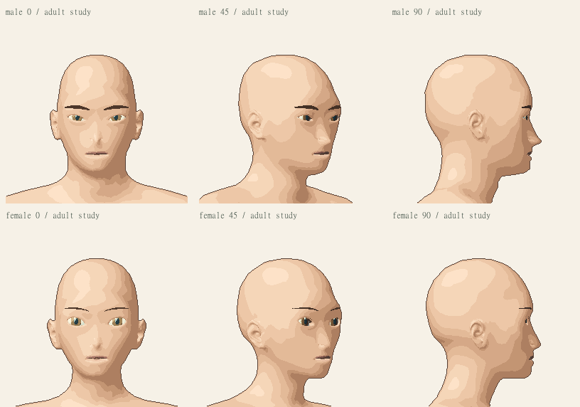

# 일본 등신·아니메 조형·참고 이미지 대조

2026-11-16. 인체 승인 전 집중 연구. 해부학은 연결과 움직임의 근거로, 일본 작화는 선택할 비례와 생략의 근거로 사용한다. 아래 내용에서 원전 요약과 프로젝트의 해석·수정안을 구분한다. 특정 작가의 스타일을 일본 전체의 표준으로 부르지 않는다.

[참고 그림과 현재 모델 대조](../../pixel-lab/reference-study.html) · [6차/7차 모델 비교](../../pixel-lab/anatomy-review.html)

## 01. MediBang — 分割を使っていろいろな頭身を描いてみよう

[일본어 원문](https://medibangpaint.com/use/2019/09/human-figure-proportions/)

**한 줄:** 머리 크기와 관절 위치를 함께 나눈다.

**한 문장:** 6등신의 상하체 구획, 손목과 사타구니, 무릎의 중간 위치를 잡고, 2·3등신은 별도 비례로 설계한다.

**주요 개념:** 머리 단위, 수직 중심선, 손목–사타구니 관계, 허벅지–종아리 관계, 데포르메.

**관찰·분석:** 본문의 6·3·2등신 도판을 열람했고 6·2등신 이미지를 직접 확인했다. 6등신 그림은 손목이 사타구니 근처에 있고, 2등신 그림은 머리가 몸 전체와 비슷한 높이를 차지한다. 기존 모델은 머리 수만 달리하면서 골반이 낮아 몸통이 길고 손목이 지나치게 아래에 있었다. 이는 그림체 차이를 넘어 비교 기준 자체가 불안정한 상태였다.

**프로젝트 적용:** 골반 관절과 사타구니를 같은 점으로 취급하지 않고, 사타구니보다 위에 관절을 둔 뒤 손목 높이를 맞췄다. 전체 키 정렬과 머리 단위 정렬을 별개로 구현했다. 도판의 비율은 시작 기준이며 모든 사람의 실측 평균으로 주장하지 않는다. 다음 비교는 어깨·허리·무릎의 높이 오차를 기록하는 것이다.

## 02. MediBang・遥川遊 — 魅力をギュッとコンパクトに！ミニキャラの描き方

[일본어 원문](https://medibangpaint.com/use/2021/10/how-to-draw-charming-mini-characters/)

**한 줄:** 머리 아래에 작고 둥근 몸을 매단다.

**한 문장:** 2·2.5·3등신의 용도 차이를 설명하며, 큰 머리와 낮게 모인 이목구비, 단순한 손발, 물방울처럼 아래로 부푸는 몸통으로 읽히는 형태를 만든다.

**주요 개념:** 큰 머리, 낮은 얼굴 요소, 둥근 턱, 몸통의 부피, 단순한 손발.

**관찰·분석:** 원문 2등신·3등신 그림을 직접 확인했다. 얼굴은 위가 넓고 아래가 둥글며, 목에서 배로 이어지는 외곽선이 끊기지 않는다. 3등신은 2등신을 세로로 늘린 것에 그치지 않고 팔과 다리의 표현 여유가 달라진다. 기존 모델의 가는 허리와 관절 돌출은 이 실루엣을 방해했다.

**프로젝트 적용:** 2~4등신의 머리 폭을 넓히고 어깨를 줄였으며 몸통의 잘록함을 약하게 했다. 손은 손가락 다섯 개를 억지로 축소하기보다 둥근 덩어리로 묶었다. A·B·C의 머리 폭을 달리한 9개 비교를 생성했다. 아직 표정과 무게중심이 충분히 귀엽다는 판정은 하지 않았다.

## 03. CLIP STUDIO 공식 — 人体デッサンのポイント

[일본어 원문](https://tips.clip-studio.com/ja-jp/articles/1722)

**한 줄:** 등신선을 정한 뒤 몸의 주요 지점을 배치한다.

**한 문장:** 머리 단위를 기준으로 어깨·사타구니·무릎·팔의 위치를 잡고, 얼굴의 눈·코·입 간격을 검토하되 비례 지식이 그림을 경직시키지 않도록 한다.

**주요 개념:** 큰 배치 선행, 얼굴 기준선, 포즈와 비례, 변형의 자유.

**분석·적용:** 공식 강의의 설명을 읽었다. 성별·나이에 대한 예시는 강사의 작화 관습이며 모든 몸에 적용할 규칙으로 사용하지 않는다. 남녀 모두 같은 독립 체형 조절축을 유지하고, 망가풍에서는 어깨 폭과 다리 비율을 별도로 조절했다. 고정 자세를 비교 기준으로 쓰되 그것만으로 자연스러운 자세를 완성했다고 판단하지 않는다. 확대 화면에서 발견한 눈의 돌출은 홍채·동공·눈썹을 얼굴 곡면에 붙이는 수정으로 연결했다.

## 04. Palmie — かわいく2・3頭身にデフォルメするコツ

[일본어 원문](https://www.palmie.jp/lessons/94)

**한 줄:** 작아져도 알아볼 특징은 남기고 나머지는 과감히 줄인다.

**한 문장:** 2등신에서는 좁은 어깨·둥근 턱·낮은 얼굴 요소·약한 관절 굴곡으로 단순화하고, 3등신에서는 팔다리와 세부 표현의 범위를 다시 정한다.

**주요 개념:** 특징의 강조, 윤곽선 우선, 선 수 감소, 등신별 재설계.

**분석·적용:** 무료 본문 설명을 확인했다. 유료 강의 전체를 수강한 것으로 기록하지 않는다. 프로젝트의 작은 기본형은 성인형 메시를 축소한 것처럼 보이는 것이 문제였다. 머리 폭 후보와 단순한 손 모양을 먼저 실험했고, 가슴 형태 조절은 작은 등신에 적용되지 않도록 검사했다. 향후의 귀여움 평가는 큰 머리를 몸 위에 얹었는지가 아니라 얼굴과 몸이 한 실루엣으로 읽히는지를 중심으로 한다.

## 05. Palmie — ちびキャライラスト特集

[일본어 원문](https://www.palmie.jp/lessons/257)

**한 줄:** 같은 등신도 손발과 바깥 실루엣에 따라 인상이 달라진다.

**한 문장:** 여러 제작 사례를 통해 등신 변화와 손발 크기가 캐릭터의 안정감·활동성에 영향을 주는 방식을 비교한다.

**주요 개념:** 사례 비교, 손발 비율, 외곽 부피, 디자인의 선택.

**분석·적용:** 설명과 작품별 소개를 읽었다. 참여 작가들의 모든 이미지를 정밀 측정한 것은 아니다. 손발이 작아야만 귀엽다는 단일 규칙을 채택하지 않는다. 현재 A·B·C 후보에는 머리 폭 차이가 있지만 손발 크기까지 충분히 독립적인 시안은 아니다. 다음 실험에서는 머리 폭을 고정한 채 발 크기와 양발 간격만 바꾸어 안정감이 달라지는지 비교한다.

## 06. MediBang・吉田セツ — 全身をうまく描くための4つのコツ

[일본어 원문](https://medibangpaint.com/use/2021/02/4-tips-for-drawing-the-whole-body/)

**한 줄:** 팔과 손의 길이도 몸의 비례에 포함한다.

**한 문장:** 상하체와 팔·다리 구간의 관계, 손목의 높이, 얼굴에 견준 손 크기를 전신 작화의 출발점으로 제시한다.

**주요 개념:** 분절 길이, 손 크기, 손목 높이, 평균과 개별 차이.

**분석·적용:** 기존 손은 전신에 비해 작았고 팔 끝의 장식처럼 보였다. 성인 손의 길이를 늘리고 엄지와 네 손가락의 길이 차이를 구현했다. 참고 비례는 작화용 근사값이다. 현재 손가락의 관절 방향과 손바닥 회전까지 정확한 손 해부학이 구현된 것은 아니다. 45도와 옆면에서 손이 납작하게 찌그러지지 않는지 계속 확인한다.

## 07. MediBang・吉田セツ — 全身のアタリの描き方

[일본어 원문](https://medibangpaint.com/use/2021/02/how-to-draw-a-rough-sketch-of-the-whole-body/)

**한 줄:** 팔은 흉곽 옆에 직접 붙는 막대가 아니다.

**한 문장:** 머리와 척추, 흉곽과 골반, 팔다리를 구분하고 쇄골·견갑골과 골반 관절을 통해 연결되는 구조를 작화의 바탕으로 삼는다.

**주요 개념:** 몸통 덩어리, 어깨띠, 고관절, 척추의 흐름.

**분석·적용:** 팔의 시작점을 흉곽 외곽과 구별하고, 어깨의 별도 공 모양을 없앴다. 삼각근은 위팔의 연속 표면에 포함했다. 다리는 골반 관절보다 발목이 안쪽에 오는 기본 축을 사용했다. 그러나 견갑골의 실제 회전과 쇄골의 상승은 아직 동작에 연동되지 않는다. 팔을 드는 동작에서 어깨띠가 함께 움직여야 한다는 과제가 남는다.

## 08. MediBang — 男女の描き分け・骨格

[일본어 원문](https://medibangpaint.com/use/2021/03/differences-between-male-and-female-skeletons/)

**한 줄:** 어깨·흉곽·골반의 관계를 먼저 비교한다.

**한 문장:** 성별 작화 예시에서 어깨와 흉곽, 골반의 폭·각도, 대퇴골의 방향 차이를 설명한다.

**주요 개념:** 쇄골 폭, 골반 형태, 대퇴골 각도, 측면 비교.

**분석·적용:** 여성형의 골반만 넓히고 다리를 수직으로 붙이면 가랑이와 무릎의 연결이 부자연스러웠다. 골반 폭과 다리 축을 함께 바꾸도록 수정했다. 성별 평균 경향과 개인차를 구별하기 위해 어깨·골반 폭을 독립 조절로 유지한다. 기본형은 두 가지 출발점이지 가능한 사람 체형을 두 범주로 고정하는 분류표가 아니다.

## 09. MediBang — 女の子の体を魅力的に描く方法

[일본어 원문](https://medibangpaint.com/use/2023/02/body_charm/)

**한 줄:** 가는 팔다리에도 완만한 굴곡이 필요하다.

**한 문장:** 어깨·팔·허리·엉덩이·다리의 곡선과 등신 선택을 연결해 몸의 윤곽을 구성하는 작화 방법을 소개한다.

**주요 개념:** 윤곽의 리듬, 관절 전후 굴곡, 볼륨, 표현 목적.

**분석·적용:** 여성형을 가슴과 골반 크기만으로 차별화하지 않는다. 팔과 허벅지에도 지방 부피가 적용되며, 근육 경계는 지방이 늘수록 약해진다. 가슴 크기와 허리의 잘록함을 묶지 않는다. 초기 남성 이용자층은 제품 방향으로 기록했으나 특정 몸매가 모든 남성에게 선호된다고 검증한 것은 아니다. 형태의 설득력과 이용자의 외형 선호는 별도로 비교한다.

## 10. あまちゅう — ちびの描き方

[일본어 원문](https://tips.clip-studio.com/ja-jp/articles/4899)

**한 줄:** 데포르메 뒤에도 같은 캐릭터로 읽혀야 한다.

**한 문장:** 2등신의 머리:몸, 3등신의 머리:몸통:다리 관계를 설명하고 얼굴과 종의 특징을 압축된 형태에서도 유지한다.

**주요 개념:** 특징 보존, 비례 변환, 손 모양, 사람과 수인.

**분석·적용:** 이번에는 인체 기본형만 다룬다. 다른 생물로 범위를 넓히지 않고, 같은 눈·입·얼굴형을 등신별로 기계적으로 복사했을 때 얼마나 읽히는지 검토한다. 아직 작은 전신에서 얼굴 부품 20종이 모두 구분된다고 볼 근거는 없다. 확대 얼굴 검사와 실제 표시 크기의 읽힘을 구분한다.

## 11. CrimsyCreates — How to Draw Chibis in Clip Studio Paint

[영어 원문](https://tips.clip-studio.com/en-us/articles/4953)

**한 줄:** 기본 구는 출발점이고 최종 몸은 다시 다듬는다.

**한 문장:** 영어권 작가가 일본풍 치비의 1.5~4등신과 특징별 생략을 설명하며, 초기 단순 덩어리를 최종 형태로 그대로 남기지 않도록 안내한다.

**주요 개념:** 영문 창작자 자료, 선택적 과장, 큰 형태, 덩어리의 재구성.

**분석·적용:** 일본 자료와 비교할 영어권 작가의 직접 강의다. 같은 글의 일본어 번역을 별도 원전으로 중복 계산하지 않는다. 기존 모델의 어깨 구·가슴 구·관절 구가 최종 외형처럼 보이던 문제와 연결된다. 메시를 사용하더라도 연결 부위와 바깥 윤곽을 다시 설계해야 한다. 실제 이미지를 대조하지 않은 채 구가 있다는 이유만으로 인체가 완성됐다고 보지 않는다.

## 12. Chuck Close — 격자와 큰 명암의 읽힘

[Pace Gallery 작가 페이지](https://www.pacegallery.com/artists/chuck-close/)

**한 줄:** 작은 색 단위가 멀리서 하나의 입체를 이룬다.

**한 문장:** 사진에서 얻은 정보를 격자로 조직한 초상 작업은 개별 색 단위와 전체 형상이 함께 읽히는 관계를 보여 준다.

**주요 개념:** 격자, 색과 명도의 덩어리, 관찰 거리, 전체 이미지.

**관찰·분석:** 갤러리에 게시된 《Arne》(2019–2020) 이미지를 직접 확인했다. 사각 단위마다 색과 명도가 달라도 멀리서는 눈·코·입과 얼굴의 덩어리가 유지된다. 이것을 무작위 점을 흩뿌리는 기법으로 해석하지 않는다.

**프로젝트 적용:** 5~8등신은 128·192·256px 연구 원본과 작은 표시를 함께 비교한다. 큰 명암이 흉곽·골반·팔다리 방향을 설명한 뒤 픽셀을 정리한다. 현재 모델의 단색 면과 경계는 아직 이 수준의 색 관계를 갖추지 못했다. 새로 만든 AI 기준 그림도 이 작가의 작업 수준을 재현했다는 뜻이 아니다.

## 13. 쵸파 예시와 실제 확인 범위

[ONE PIECE 공식 캐릭터 페이지](https://one-piece.com/character/chopper/)

큰 머리와 작은 몸이 자연스럽게 읽히는 방향은 사용자가 제시한 예시다. 공식 페이지의 본문은 확인했지만 이번 실행에서 원본 캐릭터 이미지 요청은 403으로 반환되어 직접 이미지 대조를 완료하지 못했다. 따라서 쵸파의 치수를 측정했다거나 그대로 대응하는 실루엣을 구현했다고 기록하지 않는다. 이번 실제 시각 비교에는 위 MediBang 도판을 사용했다.

## 14. 이미지 대조 실험과 현재 판정

**새 연구 도구:** 참고 그림 파일을 브라우저 안에서 열고 머리끝·턱·발바닥·좌우 범위를 지정한다. 전체 키를 맞추는 방식과 머리 단위를 맞추는 방식을 선택한다. 가로세로를 다른 비율로 늘리지 않으며, 나란히 보기와 투명하게 겹치기를 제공한다. 현재 자동 랜드마크 추정은 없다. 포즈와 시점이 다르면 단순 윤곽 일치를 평가 근거로 쓰지 않는다.

**생성 기준 그림:** imagegen 기본 도구로 성인 남녀의 정면·사선·측면 시안을 만들었다. 일본 등신 도판과 팔 해부 참고 이미지는 방향을 설명하는 입력이었다. 결과의 남성 근육은 강하게 분절되고 여성 가슴 윗선은 닫힌 원처럼 보여 미채택 상태다. 그림에 쓰인 7등신 숫자는 별도 측정값이 아니다. 같은 키·같은 머리 단위 대조에서 차이를 드러내도록 했다. 후속 수정은 이미지 도구의 안전 판정으로 생성되지 않았다. 이를 성공한 수정으로 세지 않는다.

**실제 모델 수정:** 성인 어깨 구 제거, 연속된 위팔·전완 표면, 대퇴부와 종아리의 비대칭, 골반–무릎–발목 축, 손발 크기, 7개 가슴 형태 조절, 흉곽·복부 표면, 귀 내부 구조, 얼굴 곡면을 따르는 눈을 구현했다. 2~4등신은 큰 머리·좁은 어깨·둥근 몸통·단순 손을 실험했다.

**남은 문제:** 몸은 여전히 경직되어 있다. 겨드랑이·어깨띠의 움직임, 무릎에서 정강이로 넘어가는 면, 눈확·광대·입 주변의 볼륨, 피부 명암의 큰 덩어리가 부족하다. 생성 기준 그림과 실제 회전 모델 사이의 품질 차이도 크다. **인체 승인 전이며 다음 콘텐츠 단계로 넘어가지 않는다.**

**자료 관리:** 참고 원본은 로컬 관찰용이다. 공개 연구 페이지에는 원문 링크와 자체 분석을 두며, 외부 도판·사진을 새 캐릭터 자산으로 배포하지 않는다. 생성 시안과 직접 구현한 모델의 결과 그림은 구분해 보관한다.

## 15. Palmie Mozu의 얼굴 정면과 옆면

[Palmie 얼굴 그리기 강의](https://www.palmie.jp/lessons/17)

**한 줄:** 얼굴 윤곽 뒤에 두개골과 턱 아래 면이 있다.

**한 문장:** 정면의 눈·코·입 배치를 옆면으로 옮길 때는 머리 뒤쪽의 부피, 얼굴 앞면의 기울기, 턱에서 목으로 돌아가는 면을 함께 구성한다.

**주요 개념:** 두개골과 얼굴 앞면, 턱 아래 면, 목의 방향, 올려다봄과 내려다봄, 옆면에서 좁아지는 눈.

**분석:** 정면만 보고 얼굴 외곽선을 만들면 옆면에서 이마·코·입·턱이 한 줄로 붙거나 목 앞쪽으로 곧장 떨어지기 쉽다. 강의의 두개골 원과 얼굴 앞면을 나눈 도판을 직접 확인했다. 위아래 시점에서는 보이는 면의 비율이 달라지므로 이목구비의 높이만 평행 이동하는 방법으로는 충분하지 않다. 이 강의의 미적 비례는 하나의 작화 선택이며 모든 사람에게 적용되는 해부학적 법칙으로 사용하지 않는다.

**모델의 결함과 적용:** 7차 얼굴은 단순한 가로 단면을 쌓았고, 코와 입을 별도 덩어리로 붙여 측면에서 떠 보였다. 8차에서는 머리의 앞·뒤 깊이를 독립적으로 정의하고 턱 아래가 목 쪽으로 돌아가게 했다. 목 뒤쪽의 부착 높이를 앞보다 올렸다. 얼굴 앞면에 코의 높낮이를 통합하고 입술은 그 표면을 따라가도록 했다.

**다음 대조:** 정면·45도·90도뿐 아니라 위·아래 45도에서 코 아래, 턱 아래, 후두부와 귀 위치가 일관되는지 살핀다. 아직 턱의 각도와 눈의 입체감은 경직돼 있다.

## 16. CLIP STUDIO의 옆얼굴과 사선 얼굴

[옆얼굴과 사선 얼굴의 그리기](https://www.clipstudio.net/oekaki/archives/176083)

**한 줄:** 얼굴의 방향을 머리 중심선과 옆면으로 맞춘다.

**한 문장:** 같은 캐릭터를 정면·사선·측면으로 돌릴 때 두개골의 부피를 먼저 유지하고 눈·코·입·귀의 위치와 보이는 폭을 시점에 맞게 조절한다.

**주요 개념:** 얼굴 중심선, 얼굴 앞면과 옆면, 후두부, 눈의 축소, 코에서 턱까지의 윤곽.

**실제 관찰:** 여성형 사선과 남성형 옆면에 두개골 원·수직선·눈높이선이 들어간 도판을 직접 비교했다. 머리 뒤쪽은 귀에서 바로 끝나지 않는다. 옆면의 눈은 정면의 둥근 눈을 그대로 붙인 모양이 아니며 코·입·턱은 연결된 윤곽을 이룬다. 머리카락 외곽과 실제 두개골 외곽을 혼동하면 맨머리 기본형의 비례가 틀어진다.

**모델의 결함과 적용:** 눈꺼풀과 눈썹의 돌출이 커서 측면에서 검은 막대처럼 보였다. 얼굴 표면에 더 가깝게 붙이고 선의 두께를 낮췄다. 귀의 내부 선도 낮고 가늘게 수정했다. 눈을 표면에 붙이는 것만으로 눈확과 안구가 완성되는 것은 아니므로 눈의 상하 면과 옆면 투영을 계속 검토한다.

**다음 대조:** 맨머리 상태에서 머리 단위와 얼굴 배치를 확인한다. 머리카락으로 덮어 결함을 가리는 방식은 기본형 채택 기준으로 삼지 않는다.

## 17. GABIzolis의 영어권 옆얼굴 연구

[Profiles for Beginners](https://tips.clip-studio.com/en-us/articles/8110)

**한 줄:** 구형 두개골에 얼굴 앞면을 구성한다.

**한 문장:** 두개골과 얼굴 앞면의 단순 구조를 출발점으로 삼아 코·입·턱의 옆면 흐름을 이해하고 다른 그림체로 조절한다.

**주요 개념:** 두개골, 얼굴 앞면, 옆얼굴 윤곽, 사실적인 구조와 스타일 변형.

**분석:** 일본풍 얼굴을 설명하는 영어권 작가의 직접 작성 자료다. 정면 눈의 크기만 키우는 방식보다 얼굴을 입체적인 면으로 이해하는 데 의미가 있다. 이 자료는 본문을 확인했으며 움직이는 도판의 모든 프레임을 대조한 것은 아니다. 일본어 자동 번역판을 또 하나의 독립 연구 자료로 계산하지 않는다.

**프로젝트 적용:** 현실형과 망가풍 모두 같은 해부학적 연결을 바탕으로 두되 코의 돌출, 턱의 폭, 눈의 크기를 별도로 조절한다. 현재 코드가 이 구조를 갖췄다는 사실은 스타일 완성도를 뜻하지 않는다. 실제 옆면 그림과 맞댔을 때 얼굴의 매력과 선의 절제가 여전히 부족하다.

## 18. 8차 기본형의 결함별 수정 기록

| 부위 | 비교에서 확인한 결함 | 적용한 수정 | 남은 문제 |
| --- | --- | --- | --- |
| 머리와 목 | 턱 아래가 납작하게 끊기고 목 뒤 연결이 낮음 | 두개골·얼굴 앞면·턱을 연속 표면으로 만들고 목 뒤 부착을 높임 | 후두부와 목의 자연스러운 기울기 |
| 코와 입 | 코·콧방울·입술이 따로 붙인 부품처럼 보임 | 코를 얼굴 표면의 높낮이로 통합하고 입술을 곡면에 밀착 | 작은 표시 크기에서 표정이 약함 |
| 귀 | 내부 선이 굵어 장신구처럼 보임 | 이륜·대이륜의 두께와 돌출 감소 | 귓바퀴의 면과 머리 부착을 추가 대조 |
| 어깨 | 위팔 상단이 몸통에서 튀어나온 기둥처럼 보임 | 쇄골 주변 단면·위팔 시작점·삼각근 최대 폭 위치 수정 | 겨드랑이와 등에서의 연결 |
| 골반 | 허벅지 위에 수평 경계가 생김 | 골반 아래 경계를 옆으로 갈수록 올리고 넓적다리 축을 조정 | 뒤쪽 둔부와 허벅지 사이의 면 |
| 발 | 좌우 대칭의 납작한 타원 | 뒤꿈치·발등·안쪽 아치·앞부분 비대칭을 가진 연속 표면 | 발가락 분리와 실제 체중 이동 |
| 3·4등신 | 몸통이 길고 다리가 짧아 머리와 몸의 균형이 깨짐 | 등신별 골반 높이를 별도로 조정 | 귀여움, 손발의 형태, 단순한 명암 |

**현재 판단:** 코·입의 분리와 일부 수평 경계는 줄었지만 전신과 얼굴 모두 채택할 완성도는 아니다. 특히 중립 자세의 경직, 어깨와 겨드랑이, 둔부와 허벅지, 작은 얼굴의 표정이 남았다. 30개 이상의 성인 여성형 몸매 확장은 기본형 안정 이후에 진행한다.

## 19. MediBang 얼굴 아타리와 비례

[일본어 원문](https://medibangpaint.com/use/2020/10/learn-about-facial-proportions/)

**한 줄:** 이목구비보다 머리와 얼굴 기준선을 먼저 정한다.

**한 문장:** 머리 외곽·중심선·눈높이를 정한 뒤 코와 입을 배치하고 전체 인상을 확인하며 조절한다.

**주요 개념:** 머리 외곽, 중심선, 눈높이, 큰 배치, 세부 조절.

**분석:** 본문의 단계별 설명을 확인했다. 눈부터 완성하고 나머지 얼굴을 끼워 맞추면 전체 균형이 흔들릴 수 있다. 눈·코·입을 이등분선에 놓는 방법은 그리기 시작을 돕는 도식이며 모든 사람의 실측 비율이 아니다.

**현재 모델과 대조:** 머리 단위를 고정한 얼굴 비교 화면을 추가했다. 새 성인 시안은 눈 사이가 좁고 남성형 눈과 입의 높이가 상대적으로 높아 보였다. 눈을 바깥으로 옮기고 입을 낮추되 정면에서만 보기 좋게 맞추지 않고 45도·옆면을 함께 확인했다. 단순 확대만으로 목표한 일본풍 얼굴이 완성되지는 않았다.

## 20. MediBang 코의 구조와 시점별 생략

[일본어 원문](https://medibangpaint.com/use/2023/04/how-to-draw-nose/)

**한 줄:** 작게 생략한 코에도 앞·옆·아래 면이 있다.

**한 문장:** 코등·양옆·아래 면을 이해한 뒤 시점에 맞게 선과 명암을 선택한다.

**주요 개념:** 코등, 양옆 면, 코 아래 면, 코끝, 시점, 생략.

**실제 관찰:** 코를 색이 다른 네 면으로 나눈 도판과 같은 얼굴에서 코 표현만 바꾼 도판을 직접 확인했다. 점 하나도 어느 구조를 뜻하는지 알고 배치해야 한다. 코끝과 귓불 높이의 관계는 해당 강의의 작화 기준으로 다룬다.

**현재 모델과 대조:** 표면을 과도하게 평활화한 D안은 코가 눌리고 입 주변의 형태가 사라졌다. E안에서 코 돌출과 입 폭을 복원하고 기하 형태의 평활화와 음영 법선의 평활화를 분리했다. F안은 입의 경계선을 표면에 붙였다. 아직 코끝의 둥근 형태와 광대 주변의 명암이 목표 그림과 다르다.

## 21. MediBang 올려다본 얼굴

[일본어 원문](https://medibangpaint.com/use/2020/01/how-to-draw-various-face-directions-aori/)

**한 줄:** 고개를 들면 턱 아래와 코 아래의 보이는 면이 바뀐다.

**한 문장:** 얼굴 곡면 위의 눈과 입, 코 아래, 턱 아래와 귀를 함께 관찰해 상하 시점의 얼굴을 구성한다.

**주요 개념:** 올려다봄, 턱 아래, 코 아래, 곡면, 단축.

**실제 관찰:** 세 얼굴의 각도 변화와 그 아래에 코·입을 단순한 입체로 대응시킨 도판을 확인했다. 고개를 들수록 코와 턱의 아래 면이 드러나고 입은 얼굴을 감싸는 방향으로 보인다.

**현재 모델과 대조:** 얼굴 부품을 화면에 평행한 장식으로 붙이지 않고 3차원 표면과 함께 회전시킨다. 자료의 원근 설명과 현재 정투영 렌더러는 구분한다. 360도 계산이 가능하다는 사실은 모든 시점의 얼굴 인상이 좋다는 판정이 아니다. 위·아래 45도에서 눈꺼풀, 콧구멍, 턱 아래의 형태를 확대 검토하는 과제가 남아 있다.

## 22. 성인 얼굴 참고 시안과 실제 모델 비교

[같은 머리 단위로 얼굴 겹쳐 보기](../../pixel-lab/face-reference.html) · [연속 전신과 기존 전신 비교](../../pixel-lab/continuous-review.html)

새 머리 시안은 imagegen 기본 도구로 만든 성인 남녀 30세의 정면·45도·옆면 참고 그림이다. 머리와 목 윗부분만 포함한다. 기존 3차원 모델의 얼굴과 CLIP STUDIO의 얼굴 구성 도판을 참고 입력으로 사용했다. 해부학적 정답이나 실제 구동 모델로 표시하지 않는다. 같은 인물의 시점별 일관성도 별도 검토 대상이다.

실제 모델과 그림을 머리끝–턱 길이에 맞춰 나란히 표시하거나 겹칠 수 있다. 수동 기준점을 바꿀 수 있고 가로세로를 서로 다른 비율로 늘리지 않는다. 처음 제공하는 기준점은 육안으로 지정한 근사값이다. 생성 그림의 완성도가 실제 모델에 자동으로 적용된 것으로 취급하지 않는다.

**현재 판정:** 연속 표면은 어깨·골반·손발의 연결을 개선했지만 얼굴은 여전히 이마·볼·턱의 명암이 부자연스럽고 목표한 일본풍의 눈과 입 형태에 미치지 못한다. 눈 간격, 입 높이, 코 부피, 안구 깊이와 눈썹 표현을 여러 차례 수정했으며 인체 승인은 보류한다. 다음 과제는 눈꺼풀의 실제 경계와 얼굴의 넓은 면을 함께 설계하는 것이다.

## 23. 작은 등신의 몸통과 얼굴 재구성

MediBang의 2·3등신 비교 도판과 얼굴·몸통 예시를 다시 직접 대조했다. 기존 8차는 머리 아래에 잘록한 단차와 관절 덩어리가 반복되어 작은 성인 인형처럼 보였다. 이번에는 2·3·4등신별 어깨·골반·팔 길이를 다시 정하고 둥근 중성 몸통과 팔다리를 하나의 연속 표면으로 구성했다. 성인 가슴이나 골반의 세부 묘사는 이 형태에 가져오지 않았다.

첫 시안에서는 팔이 몸에 붙어 보였다. 팔꿈치와 손목을 바깥으로 옮겨 빈 공간을 만들었다. 머리의 네모난 아래쪽은 둥근 곡면으로 바꾸고, 동공이 가는 선처럼 보이던 눈은 홍채를 넓혔다. A는 단순한 눈, B는 큰 홍채, C는 더 넓은 머리로 비교한다. 남녀 시작형의 차이는 작은 눈썹·눈꺼풀 표현이며 확대 검사에서 차이를 확인한다. 작은 전신에서 충분히 구별된다고 판정하지 않는다.

**발견한 구현 결함:** 4등신의 손끝이 표면 계산 범위를 넘어 열린 테두리 66개를 만들었다. 그림의 프레임 잘림 검사만으로는 발견되지 않았다. 범위를 넓히고 표면의 모든 변이 두 면에 속하는지와 몸이 한 덩어리로 연결되는지를 검사했다. 머리의 낮은 다각형 해상도와 눈 부착 곡면이 달라 눈이 떠 보이는 문제도 수정했다.

**남은 결함:** 둥근 머리가 지나치게 구처럼 보이며, 귀와 볼의 연결·옆면 눈의 인상이 아직 부족하다. 몸통과 팔다리의 단순함이 귀여움으로 이어지는지 계속 검토한다. [새 기본형을 실제로 돌려 비교](../../pixel-lab/continuous-review.html) · [남녀 2~8등신 전체 회전표](../../pixel-lab/rotation-review.html).

## 24. 성인 눈꺼풀과 코의 면을 다시 맞춘 실험

11차는 눈 선을 임의의 타원에 붙이는 대신 안구가 피부 밖으로 보이는 경계를 찾아 윗눈꺼풀 선을 붙였다. 눈썹도 관처럼 떠 있는 부품에서 피부 표면을 따르는 면으로 바꿨다. 눈의 다각형 해상도를 높이고 눈확과 홍채를 함께 조절했다.

코에는 두 차례 실패가 있었다. 평활화로 코를 눌러 버린 안과 원래 부피를 강하게 되살려 코끝이 둥글게 튀어나온 안을 비교했다. 다음 안은 코 안쪽과 바깥 표면을 같은 깊이에 모아 조각난 음영이 생겼다. 이 안은 폐기하고 기존 표면의 깊이 차이를 보존한 채 앞·옆·아래 면을 조절했다. 최종 비교안도 코와 볼의 연결, 입 주변 명암은 더 다듬어야 한다.

얼굴 확대의 회전 중심을 실제 두개골 깊이 중앙에 맞췄다. 정면에서 맞아 보이던 얼굴이 옆면에서 화면 가장자리로 치우치던 문제를 교정했다. 새 그림은 실제 렌더 결과이며 생성 참고 그림과 구분한다. **기본형은 여전히 미승인이다.**

